이번 작업은 유저가 올린 [이슈 #195, 「필드 보스 만들어주세요~!!」](https://github.com/Julian-adv/OpenMMO/issues/195)에서 시작했습니다. 여러 사람이 함께 공략하는 필드 보스 '대지파괴자 테라클래시'와 5티어 던전을 만들어 달라는 제안이었습니다.

갈라진 성채 25층의 보스 바르칸을 만들고, 보상으로 얻은 아뮬렛을 제단에 바쳐 테라클래시를 깨우는 기능을 추가했습니다.

## 원화에서 3D 모델로

바르칸은 한쪽 뿔이 부러지고 큰 날개가 달린 악마입니다. 붉은 피부에 검은 갑옷과 청동 사슬을 두르고, 균열과 룬에는 주황빛을 넣었습니다. 위에서 내려다보는 게임 시점을 고려해 뿔과 날개, 어깨의 윤곽을 잡았습니다.

원화는 Codex의 이미지 생성 도구로 만들었습니다. 검은 따로 만들기 위해 맨손으로 그렸습니다.

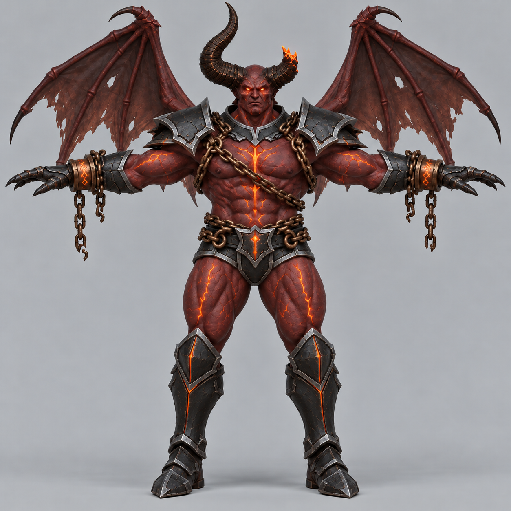

이 원화를 Tripo에 넣어 3D 모델을 만들었습니다. 처음에는 정면과 뒷면 그림을 함께 넣었습니다. 그런데 뒷면 그림의 발이 정면처럼 그려져 있어 모델의 발 뒤에도 발끝이 생겼습니다.

당시 GLB 원본의 발 부분을 확대해 렌더했습니다.

<!-- Original Tripo multiview task: 8fd4c86a-3a90-4d3c-8aa6-f0a939018ba3. GLB SHA-256: 19305ccdd0d20db9606928baca591aa3af8c43779b3560d6699a6a7ba75ff2b6. Rendered locally in Blender without changing the mesh. -->
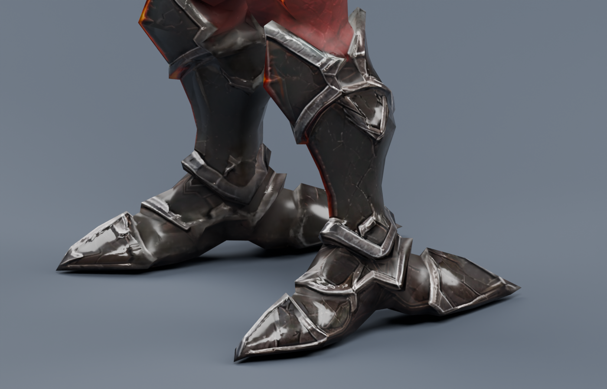

이 모델은 쓰지 않고 정면 한 장으로 다시 만들었습니다.

## 뒤꿈치와 날개 다듬기

새 모델에도 뒤꿈치에 가늘고 긴 가시가 남아 있었습니다. 수정은 Claude Opus 5.5가 했습니다.

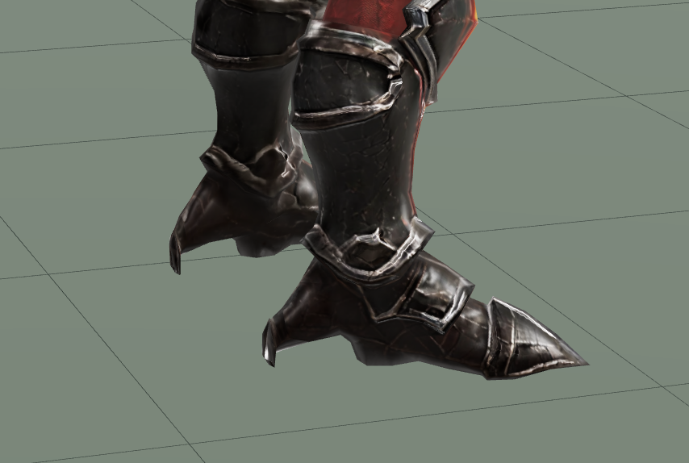

다듬을 윤곽을 빨간 선으로 표시했습니다.

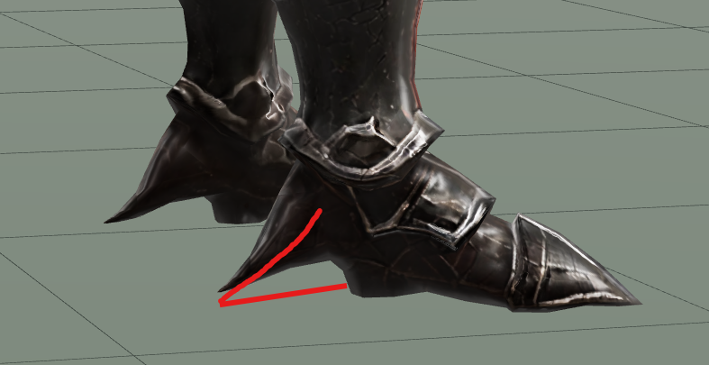

윤곽을 다듬은 뒤에는 아래처럼 빈 공간이 남았습니다. 아래쪽 면을 바닥까지 내려 메웠습니다.

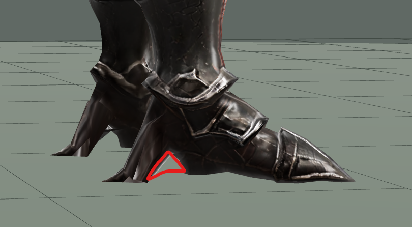

Tripo가 만든 메시에서는 날개의 찢어진 틈과 날개 끝 갈고리 안쪽이 회색 면으로 막혀 있었습니다. 수정할 부분을 표시했습니다.

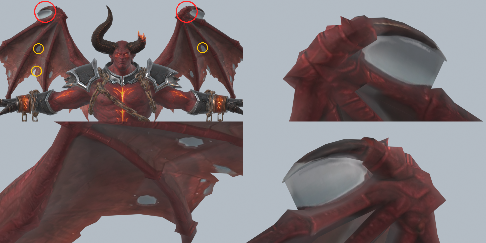

처음에는 Claude Opus 5.5에게 맡겼지만, 구멍 가장자리가 톱니처럼 남고 날개 일부가 과하게 잘려 나갔습니다.

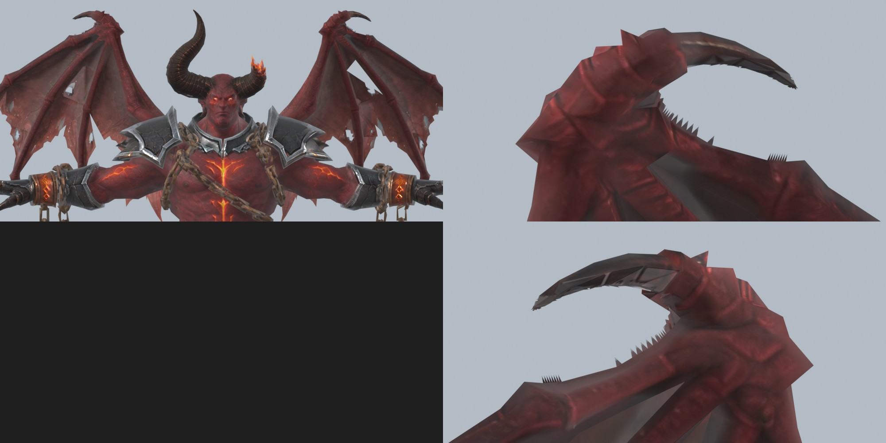

GPT-6.1 Sol에게 다시 맡겨 회색 막을 잘라 내고 구멍을 뚫었습니다.

높이는 발바닥부터 가장 높은 뿔과 날개 끝까지 2.5m로 맞췄습니다. 1.9m 플레이어와 나란히 세워 크기를 비교했습니다.

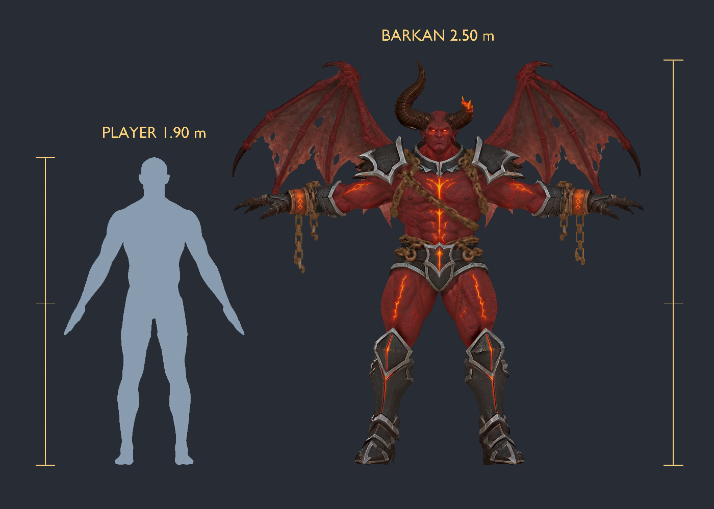

## 뼈대와 애니메이션

기존 남성 캐릭터의 뼈대를 바르칸 체형에 맞추고, 날개와 손목 사슬에 뼈를 추가했습니다. 대기와 걷기는 Mixamo의 Orc Idle과 Orc Walk를 옮겨 붙였습니다.

걷기 동작을 옮겼을 때 몸이 좌우로 크게 흔들렸습니다. 움직임의 크기를 맞추는 기준을 골반 높이에서 다리 길이로 바꾸고, 발이 바닥에 닿도록 보정했습니다. 게임에서 발이 미끄러져 보이는 문제도 있어 이동 속도를 조정했습니다.

날개는 대기하거나 걸을 때 조금씩 움직이고, 손목 사슬은 팔을 따라가면서 아래로 늘어지게 했습니다. 아래의 날개 접기·펼치기 애니메이션은 GPT-6.1 Sol로 만들었습니다.

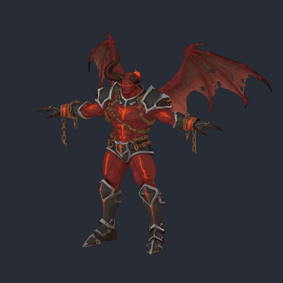

## 룬 블레이드와 검격

바르칸의 무기는 룬 블레이드입니다. 검을 따로 만들어 오른손에 장착하고, 손가락이 손잡이를 감싸도록 조정했습니다.

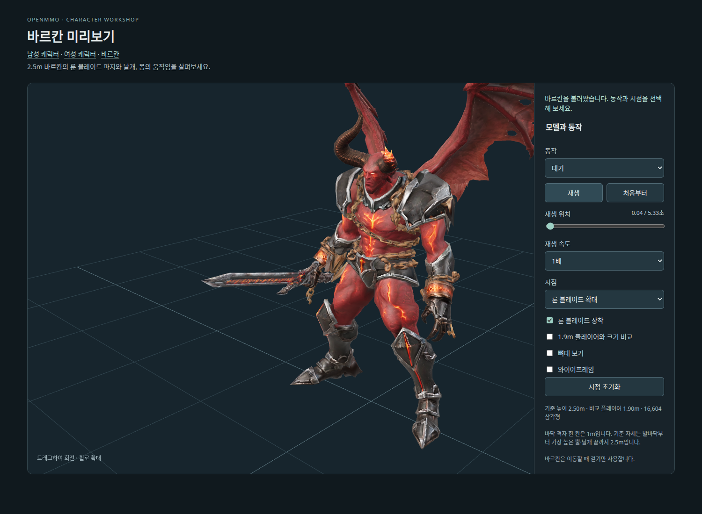

특수 공격인 룬 검격은 플레이어의 인챈트 동작과 베기 동작을 이어 만들었습니다. 검을 머리 위로 들어 룬을 빛낸 뒤 휘두릅니다. 동작을 연결할 때 검이 얼굴과 가슴을 통과해 팔의 벌어짐과 검의 방향을 조정했습니다.

검의 궤적에 주황색 잔상을 넣고, 전방에 부채꼴로 불꽃이 번지게 했습니다. 피해 판정도 검이 지나가는 시점에 맞췄습니다. 검을 들어 올릴 때 정면에서 벗어나야 피할 수 있습니다.

## 대지의 아뮬렛

바르칸을 쓰러뜨리면 보스방의 개인 보상 상자에서 확률적으로 대지의 아뮬렛을 얻을 수 있습니다.

바르칸이 대지 수호자의 심장을 빼앗아 그 힘을 봉인한 물건이라는 설정입니다. 돌 심장을 철 띠와 사슬로 묶고, 균열에 용암빛을 넣었습니다. 앞쪽 띠에는 봉인 문양을 새겼습니다.

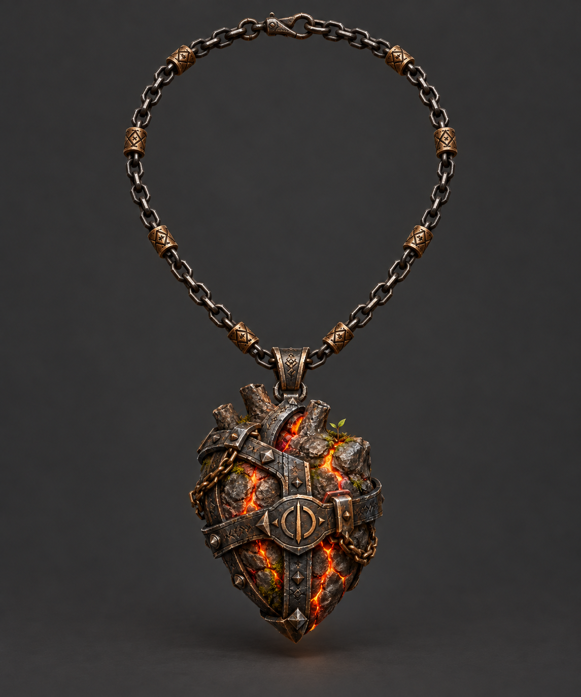

목에 착용하면 레벨당 최대 HP가 1씩 늘어납니다. 제단에 바치면 아뮬렛이 소모되고 테라클래시가 깨어납니다. 계속 착용하다가 여분을 얻으면 소환에 쓸 수도 있습니다.

## 제단 봉헌

제단에는 아뮬렛과 같은 봉인 문양을 새기고, 윗면에 돌 심장 모양의 홈을 팠습니다. 아래는 제단의 원화입니다.

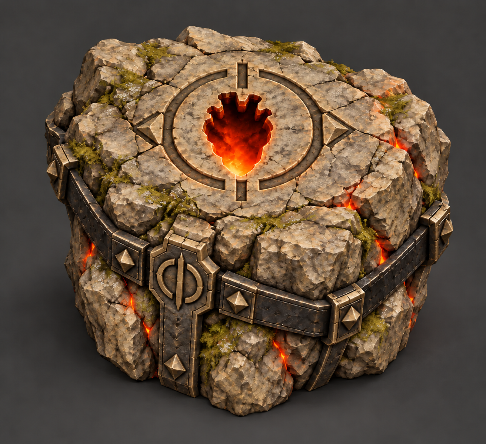

게임에 배치한 모습입니다.

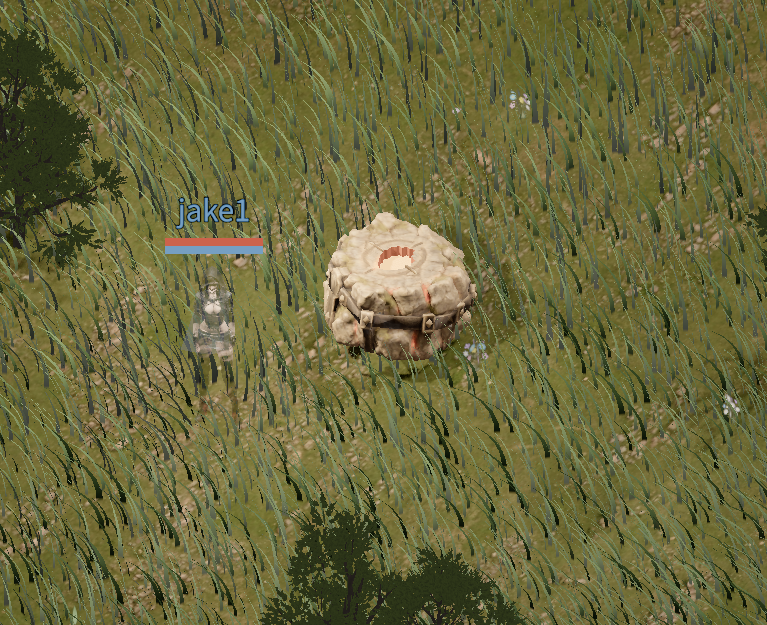

해가 진 뒤 보름달이 떠 있을 때 봉헌할 수 있습니다. 아뮬렛을 장비에서 빼 가방에 넣고 제단을 누르면, 소모할 아이템을 확인한 뒤 바칠 수 있습니다. 이미 레이드가 진행 중이거나 조건이 맞지 않으면 아뮬렛은 소모되지 않습니다.

참가자는 봉헌 전에 미리 모으도록 했습니다. 한 사람이 소환하면 아뮬렛이 없는 플레이어도 전투에 합류할 수 있습니다.

## 테라클래시의 각성

테라클래시는 심장을 빼앗긴 뒤 석화되어 제단 곁에 바위 언덕으로 남아 있었다는 설정입니다. 아뮬렛의 힘이 돌아오면 깨어나지만, 오염된 힘 때문에 폭주합니다.

땅에서 상반신만 솟은 화강암 거인으로 만들었습니다. 어깨는 산봉우리 모양이고, 가슴에는 심장이 빠져나간 구멍이 있습니다. 아래는 원화입니다.

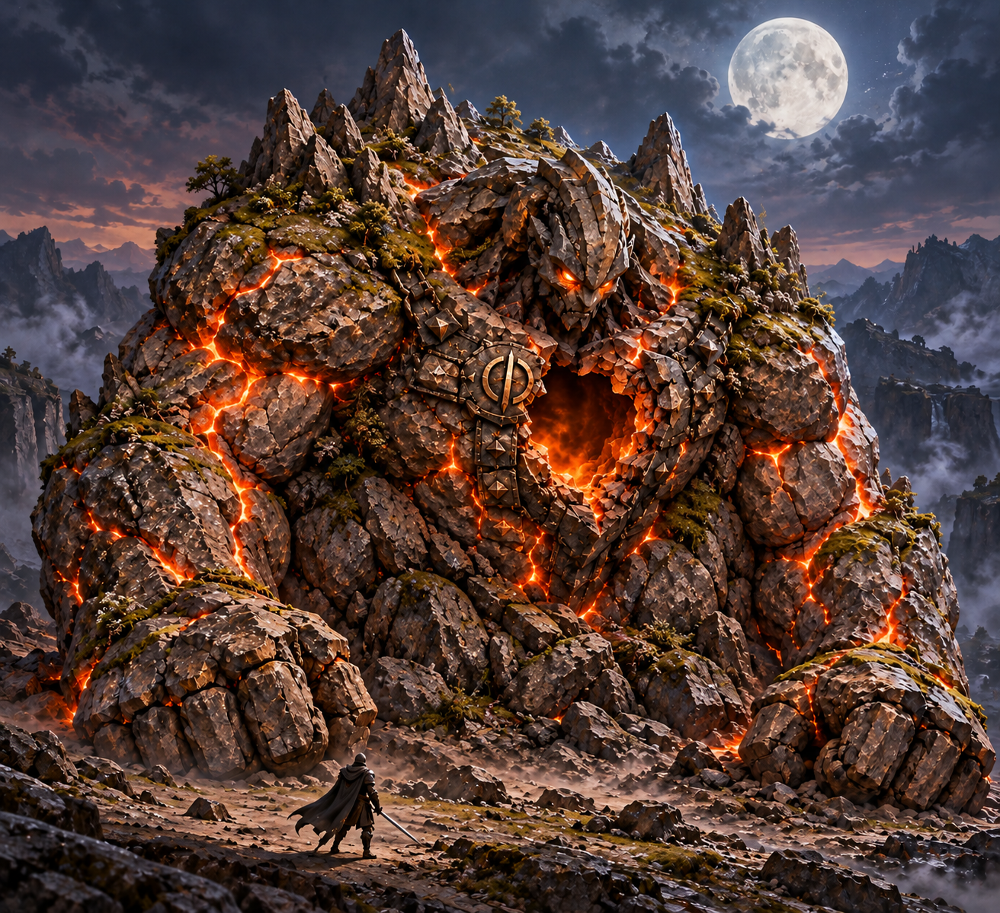

원화는 멋졌지만, 실제 게임에 구현하니 이렇게 되었습니다.

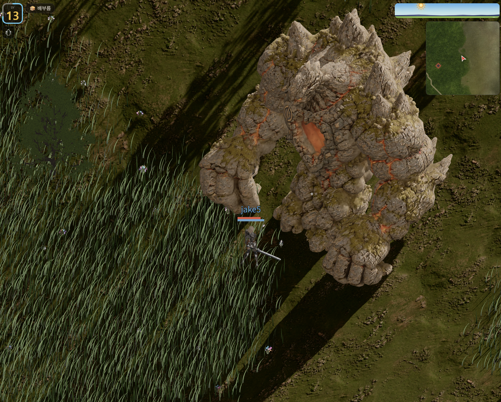

잠든 상태와 깨어난 상태의 모델을 따로 만들었습니다. 아래는 깨어나기 전 모델을 게임에 배치한 모습입니다.

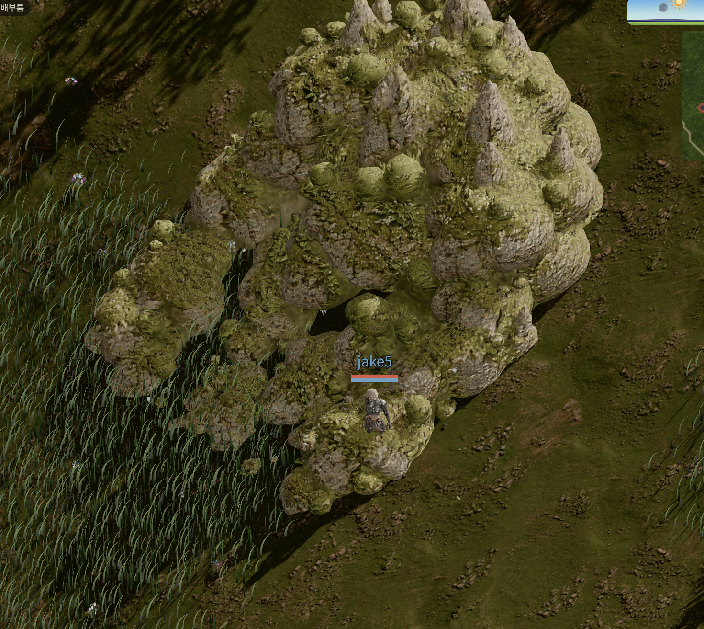

봉헌하면 바위가 흔들리고 밑동에서 흙먼지와 돌, 불씨가 올라옵니다. 바위가 가라앉으면서 흙먼지와 파편이 퍼지고, 그 사이에 깨어난 모델로 교체합니다.

인간형이 아닌 보스는 기존 뼈대와 동작을 활용하기 어려워 만들기가 까다로웠습니다. 이런 형태의 보스는 다시 만들고 싶지는 않습니다.

게임 접속: [openmmo.to.nexus](https://openmmo.to.nexus)
