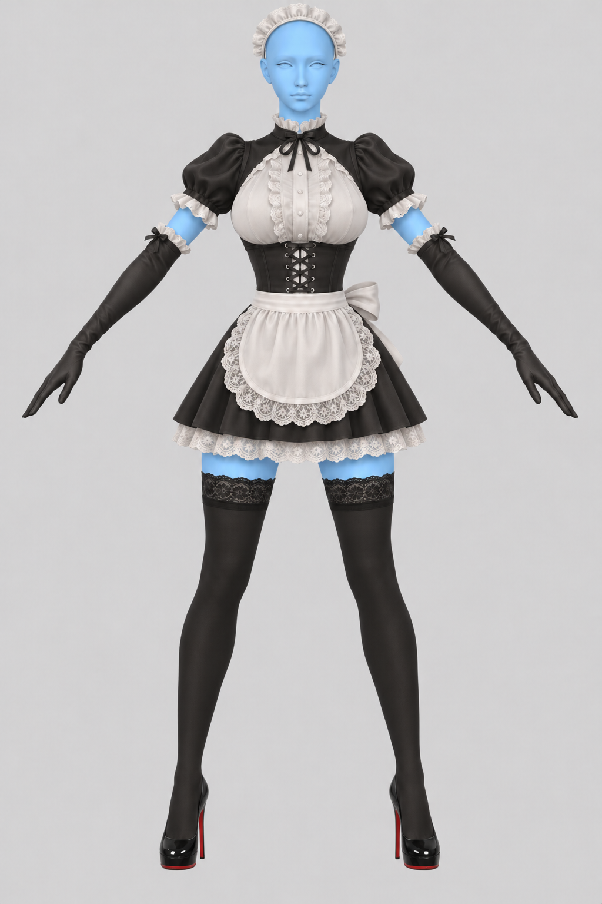
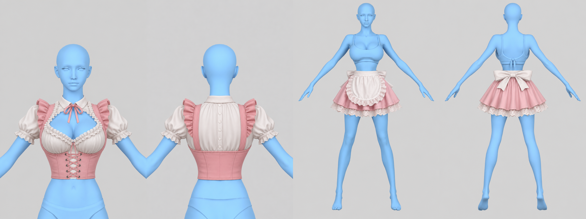

바드 의상을 만들 때는 베이스 캐릭터에 맞춰 복장 전체를 원화 한 장에 그렸습니다. 덕분에 피팅과 리깅은 수월했지만, Tripo의 Segment 기능을 써서 모델을 상의, 치마, 장갑 같은 파트로 직접 나눠야 했습니다. 장갑과 소매가 붙어 있으면 브러시로 경계를 다시 그렸습니다. [바드 의상 제작 일지](/blog/tripo-segment-modular-outfits/)

이번에는 페이블 5.2가 베이스 캐릭터와 체형과 자세가 같은 파란 마네킹을 그렸습니다. 그 위에 장비를 한 파트씩 그려서 원화 한 장에 장비 하나만 담았습니다. 상의를 그린 원화에서는 목과 손처럼 옷 밖으로 드러난 부분이 마네킹의 파란색 그대로입니다.

페이블 5.2가 Tripo API에 파트별 원화를 보내 3D 모델을 생성합니다. 모델에서도 마네킹은 파란색이라 페이블이 몸체를 구분해 잘라내면 장비만 남습니다. 이 과정에서 사람이 Tripo의 Segment 도구로 파트를 고르거나 브러시로 경계를 고칠 필요가 없습니다.

[이 링크를 눌러 트리포에 가입하시면 할인을 받을 수 있습니다.](https://studio.tripo3d.ai/?utm_source=creator_invite&utm_medium=linkcopy&utm_campaign=referral_landing_page&invite_code=W0EX4I&uid=8878291)

[OpenMMO에서 직접 플레이해 볼 수 있습니다.](https://openmmo.to.nexus)

이 작업에 사용한 프롬프트와 중간 단계 원화 등 제작 자료는 [OpenMMO GitHub 저장소](https://github.com/Julian-adv/OpenMMO)에서 볼 수 있습니다.
