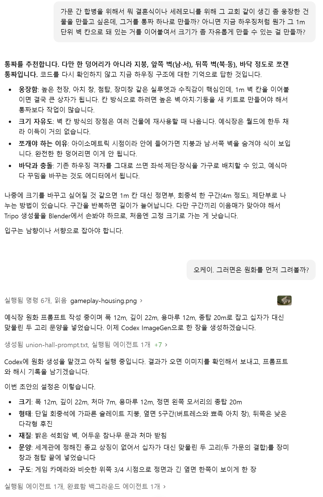
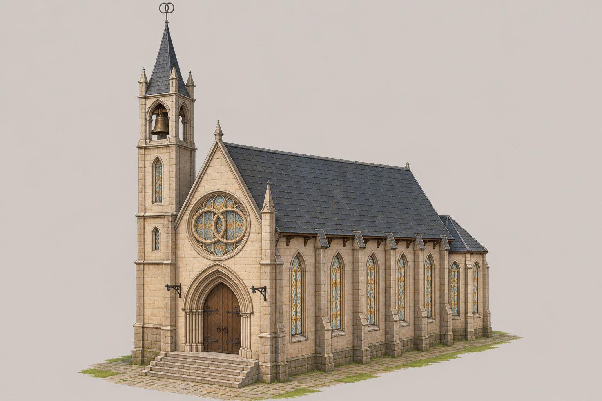
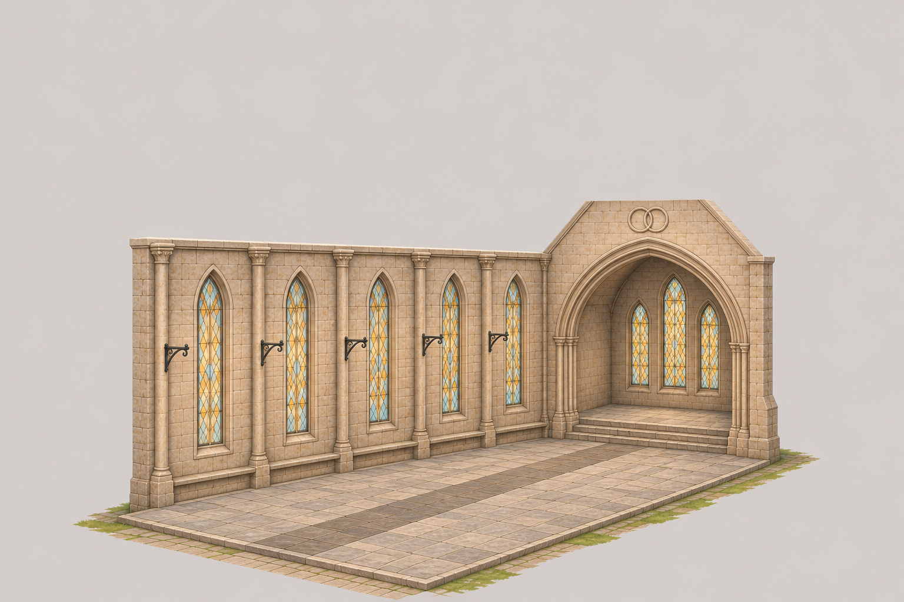
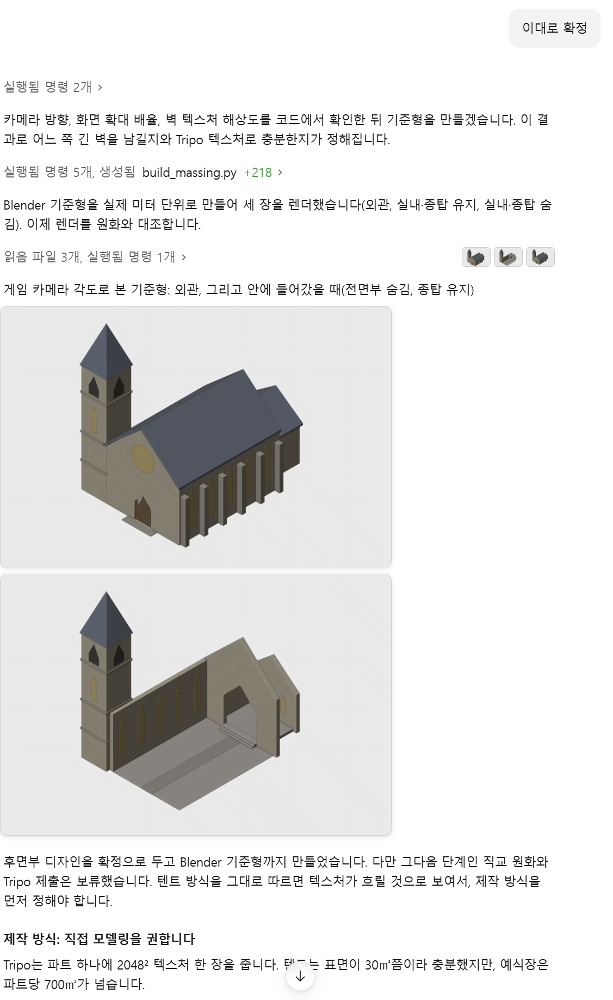
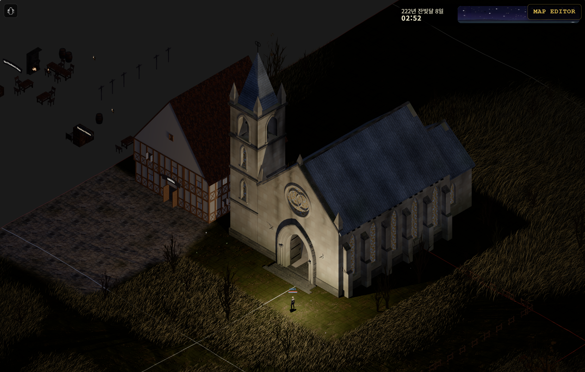
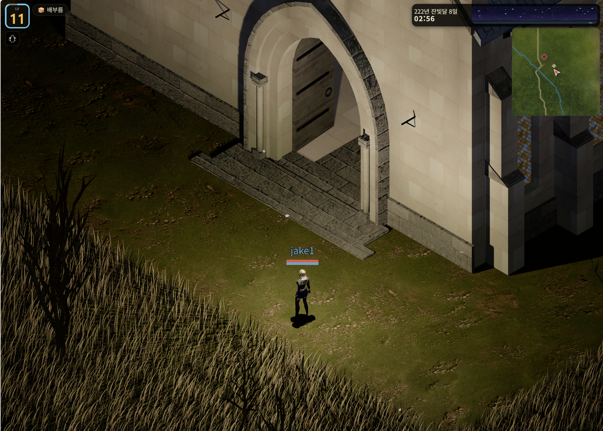
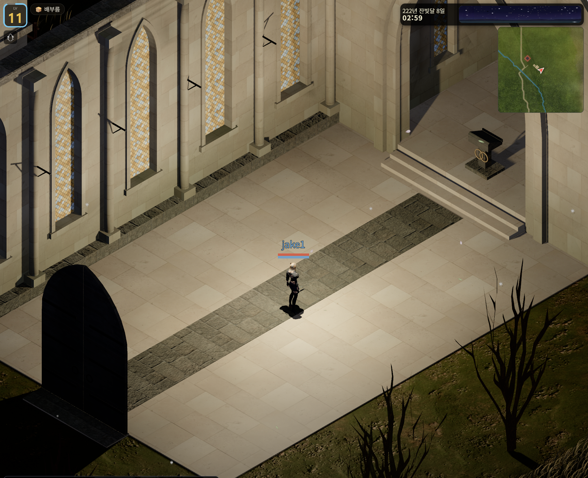

게임에 교회 건물을 추가했습니다. 이 건물은 Fable 5.2가 Blender를 직접 사용해 혼자 제작했습니다. 트리포(Tripo) 같은 외부 3D 애셋 생성기는 사용하지 않았습니다.

## 교회를 만들게 된 이유

가문 간 합병을 위한 결혼식이나 세리머니를 치를 공간이 필요했습니다. 교회처럼 생긴 웅장한 예식장을 만들고 싶어 Fable 5.2와 제작 방식을 먼저 이야기했습니다.

처음에는 전용 건물로 만들지, 기존 하우징처럼 1m 단위의 벽을 이어 붙일지 고민했습니다. Fable 5.2는 전용 건물로 만들되 지붕, 앞쪽 벽, 뒤쪽 벽, 바닥을 나누는 방식을 제안했습니다.

아래는 Fable 5.2와의 대화 스크린샷입니다. (제 말투가 구어체인 것은 타이핑 대신 마이크로 받아쓰기를 했기 때문입니다.)

## 최초 원화

위 대화를 바탕으로 Fable 5.2가 Codex의 image gen을 사용해 만든 원화입니다.

## Blender로 기준형 만들기

원화를 정한 뒤 Fable 5.2가 먼저 Blender로 대략적인 3D 모델을 만들었습니다. 미터 단위로 건물의 크기와 형태를 잡고, 게임 카메라 각도에서 렌더링해 원화와 비교했습니다.

외관뿐 아니라 지붕과 앞쪽 벽을 숨긴 실내 모습도 확인했습니다. 아래는 세부 작업 전의 기준형과 제작 방식에 관한 대화입니다.

## Tripo 대신 직접 모델링한 이유

기준형을 확인한 뒤 Fable 5.2는 최종 모델도 Blender에서 직접 제작하자고 제안했습니다. 당시 검토한 Tripo 방식은 파트 하나에 2048×2048 텍스처 한 장을 사용했습니다. 교회는 각 파트의 표면적이 커서, 이 해상도로는 가까이에서 볼 때 벽과 장식의 무늬가 흐려질 것으로 봤습니다.

그래서 Tripo로 건물을 생성하는 대신 Blender에서 직접 모델링하는 방식으로 진행했습니다.

## 텍스처 적용과 반복 수정

텍스처는 기존 하우징과 도로 등에 쓰던 것을 재사용했습니다. 제가 어떤 텍스처를 쓸지 지정하지 않았습니다. Fable 5.2가 게임 폴더에서 적당한 텍스처를 스스로 찾아 적용했습니다.

Fable 5.2는 스스로 스크린샷을 찍어 결과를 확인하고 모델을 수정했습니다. 이 과정을 여러 번 반복하며 디테일을 보완해 교회를 완성했습니다.

## 게임에 적용한 모습

아래는 완성한 교회를 게임에 배치한 모습입니다.

입구를 가까이에서 본 모습입니다.

교회 내부 모습입니다.

## 세 줄 요약

- Fable 5.2는 모델링도 잘한다.
- Blender를 직접 사용해 혼자서도 잘 만든다.
- 외부 3D 애셋 생성기 없이 교회 외관과 내부를 완성했다.

※ 일반적인 건축물이나 각진 형태의 물체는 Fable 5.2가 스스로 만들 수 있습니다. 다만 캐릭터처럼 유기적인 형태를 모델링할 때는 아직 Tripo를 사용하는 편이 더 좋을 것 같습니다.

[이 링크를 눌러 트리포에 가입하시면 할인을 받을 수 있습니다.](https://studio.tripo3d.ai/?utm_source=creator_invite&utm_medium=linkcopy&utm_campaign=referral_landing_page&invite_code=W0EX4I&uid=8878291)

[Tripo 공식 카카오톡 오픈채팅방](https://open.kakao.com/o/p9QNacSi)

[Tripo 공식 네이버 카페](https://cafe.naver.com/tripokorea)

게임은 [여기서 플레이할 수 있습니다](https://openmmo.to.nexus).

게임 소스는 [OpenMMO GitHub 저장소](https://github.com/Julian-adv/OpenMMO)에서 볼 수 있습니다.
