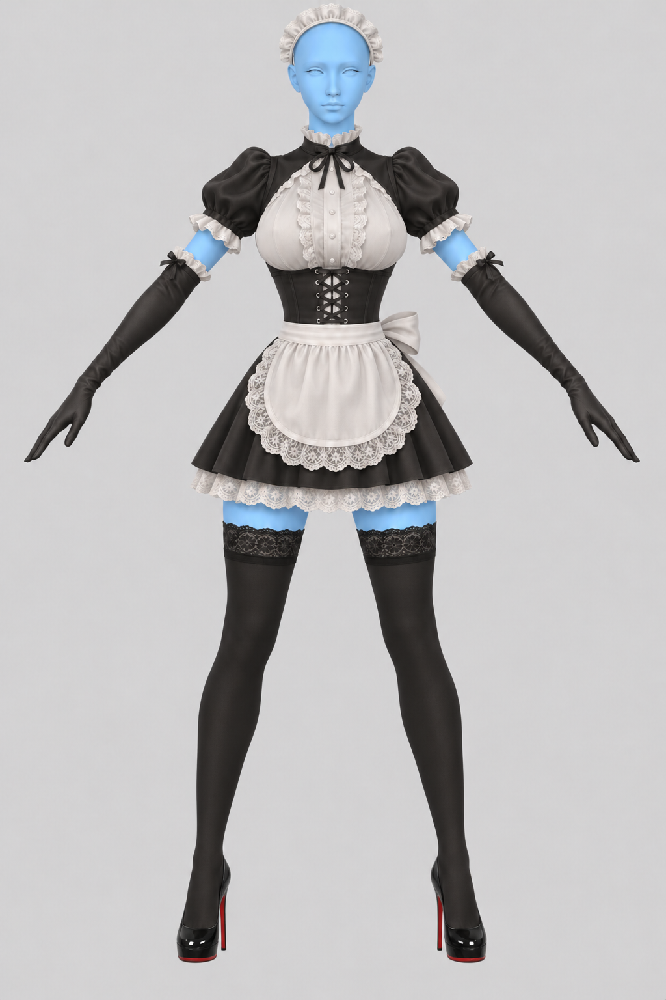
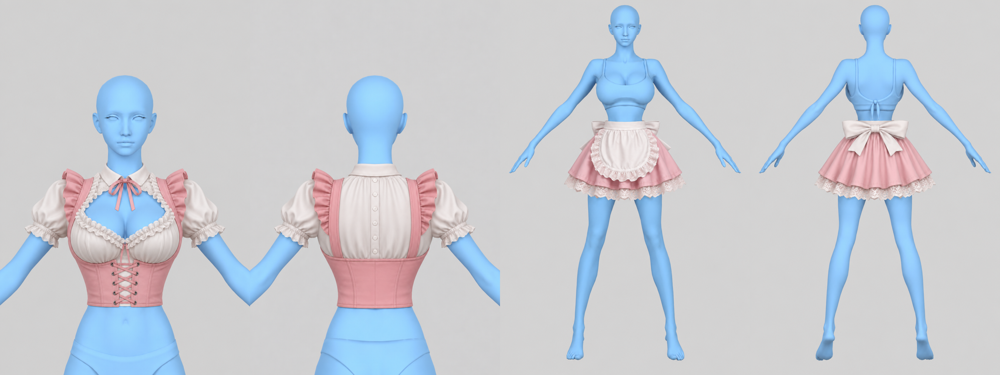

For the bard outfit, I used a single concept image showing the whole outfit on the base character. That made fitting and rigging easier, but I still had to use Tripo’s Segment tool to separate the model into pieces such as the top, skirt, and gloves. When a glove and sleeve were joined, I used a brush to redraw the boundary. [Bard outfit development log](/blog/en/tripo-segment-modular-outfits/)

This time, Fable 5.2 drew a blue mannequin with the same build and pose as the base character. It drew one piece of equipment at a time on the mannequin, giving each piece its own concept image. In the image for a top, exposed areas such as the neck and hands keep the mannequin’s blue color.

Fable 5.2 sends the concept image for each piece to the Tripo API to generate a 3D model. The mannequin stays blue in the model, so Fable can identify and remove the body, leaving just the equipment. I no longer need to select parts in Tripo’s Segment tool or correct their boundaries with a brush.

[Sign up for Tripo through this link to receive a discount.](https://studio.tripo3d.ai/?utm_source=creator_invite&utm_medium=linkcopy&utm_campaign=referral_landing_page&invite_code=W0EX4I&uid=8878291)

[You can play OpenMMO here.](https://openmmo.to.nexus)

The prompts, intermediate concept art, and other production materials used for this work are available in the [OpenMMO GitHub repository](https://github.com/Julian-adv/OpenMMO).
