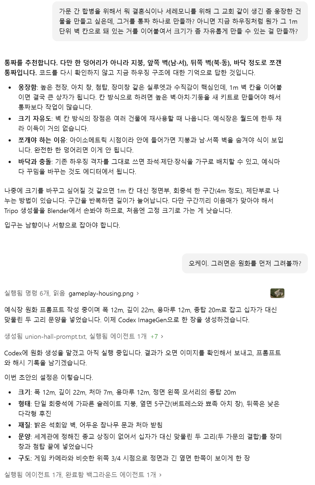
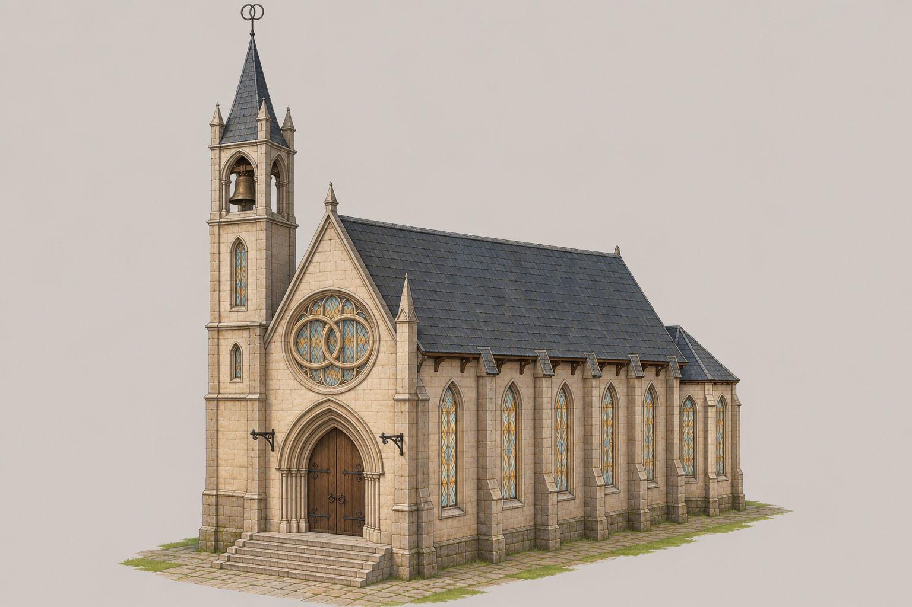
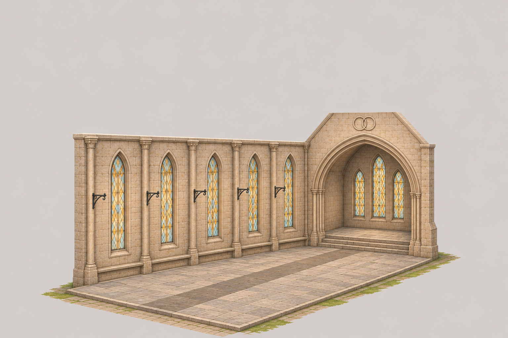
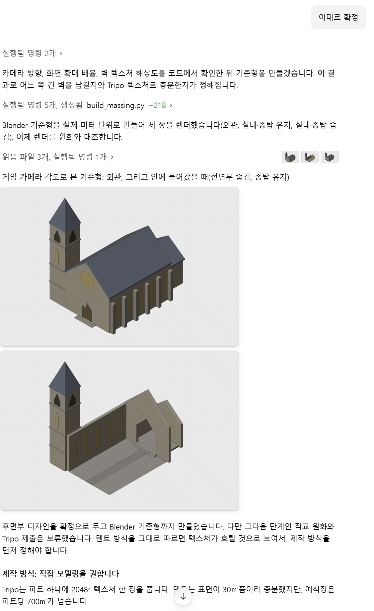
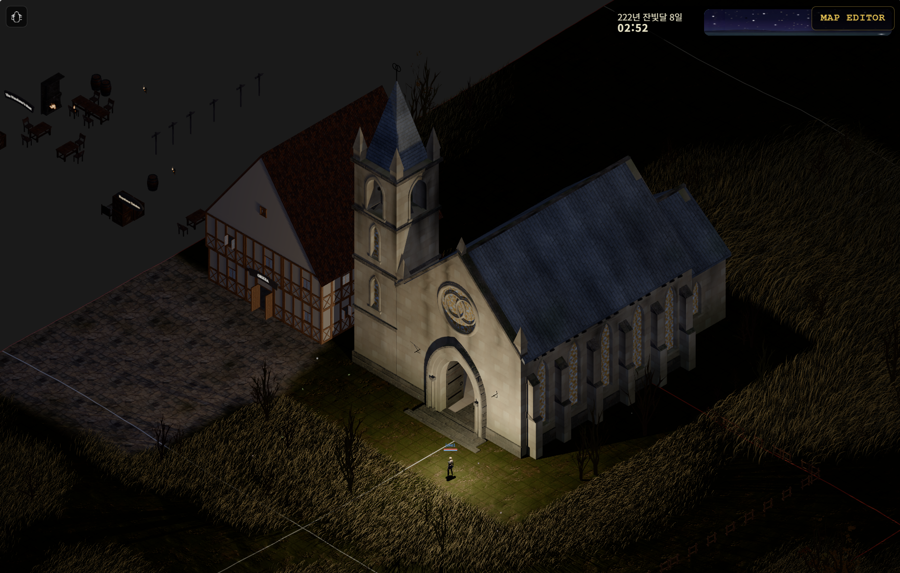
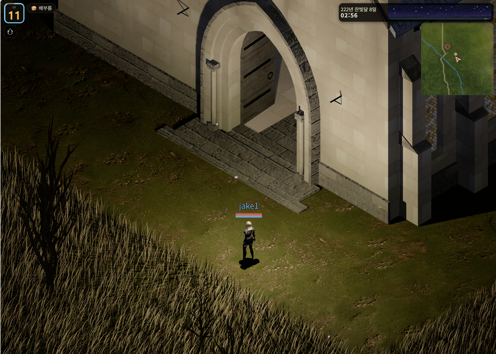
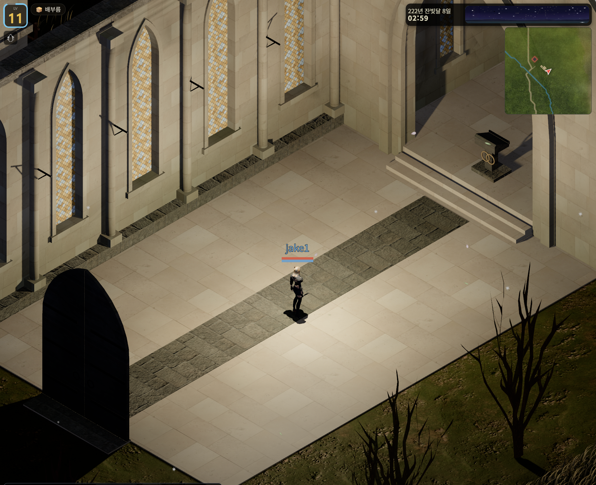

I added a church building to the game. Fable 5.2 built it on its own, using Blender directly. No external 3D asset generators such as Tripo were used.

## Why I Built the Church

I needed a venue for weddings and ceremonies marking a merger between families. I wanted a grand ceremony hall that looked like a church, so I first discussed how to build it with Fable 5.2.

At first, I considered whether to make a dedicated building or assemble it from 1 m wall sections like the existing housing system. Fable 5.2 suggested a dedicated building with separate roof, front walls, rear walls, and floor.

Below is a screenshot of the conversation with Fable 5.2. (My wording is conversational because I used microphone dictation instead of typing.)

## Initial Concept Art

This is the concept art Fable 5.2 created using Codex image gen, based on the conversation above.

## Building a Blockout in Blender

After the concept art was settled, Fable 5.2 first built a rough 3D model in Blender. It established the building's dimensions and shape in meters, then rendered it from the game camera angle to compare it with the concept art.

It checked the exterior, then the interior with the roof and front walls hidden. Below is a screenshot showing the blockout before detail work and the discussion about the production method.

## Why We Modeled It Directly Instead of Using Tripo

After reviewing the blockout, Fable 5.2 suggested building the final model directly in Blender as well. The Tripo workflow considered at the time used one 2048×2048 texture per part. Each part of the church had a large surface area, so the wall and decorative patterns were expected to look blurry up close at that resolution.

We therefore proceeded with direct modeling in Blender instead of generating the building with Tripo.

## Applying Textures and Revising the Model

The textures were reused from existing housing, roads, and other assets. I did not specify which textures to use. Fable 5.2 found suitable textures in the game folder and applied them on its own.

Fable 5.2 took screenshots on its own to review the results and revise the model. It repeated this process several times, adding detail until the church was complete.

## The Result in the Game

Below is the finished church placed in the game.

Here is a closer view of the entrance.

Here is the church interior.

## Three-Line Summary

- Fable 5.2 is good at modeling, too.
- It works well on its own, using Blender directly.
- It completed the church's exterior and interior without external 3D asset generators.

※ Fable 5.2 can build ordinary buildings and objects with angular shapes on its own. For modeling organic forms such as characters, I think using Tripo is still the better option for now.

[Sign up for Tripo through this link to receive a discount.](https://studio.tripo3d.ai/?utm_source=creator_invite&utm_medium=linkcopy&utm_campaign=referral_landing_page&invite_code=W0EX4I&uid=8878291)

[Tripo Official KakaoTalk Open Chat](https://open.kakao.com/o/p9QNacSi)

[Tripo Official Naver Cafe](https://cafe.naver.com/tripokorea)

You can [play the game here](https://openmmo.to.nexus).

The game source code is available in the [OpenMMO GitHub repository](https://github.com/Julian-adv/OpenMMO).
