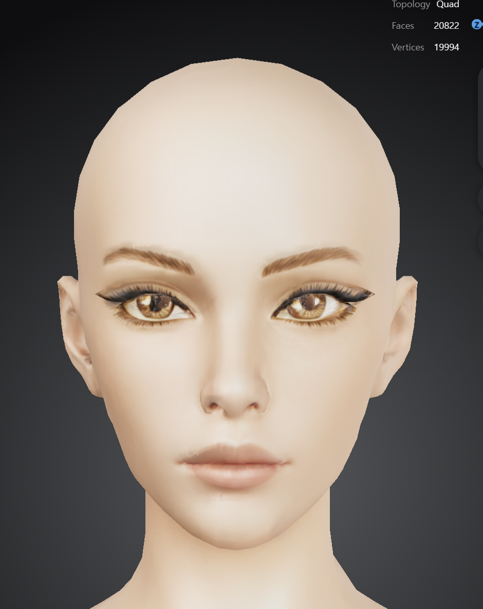
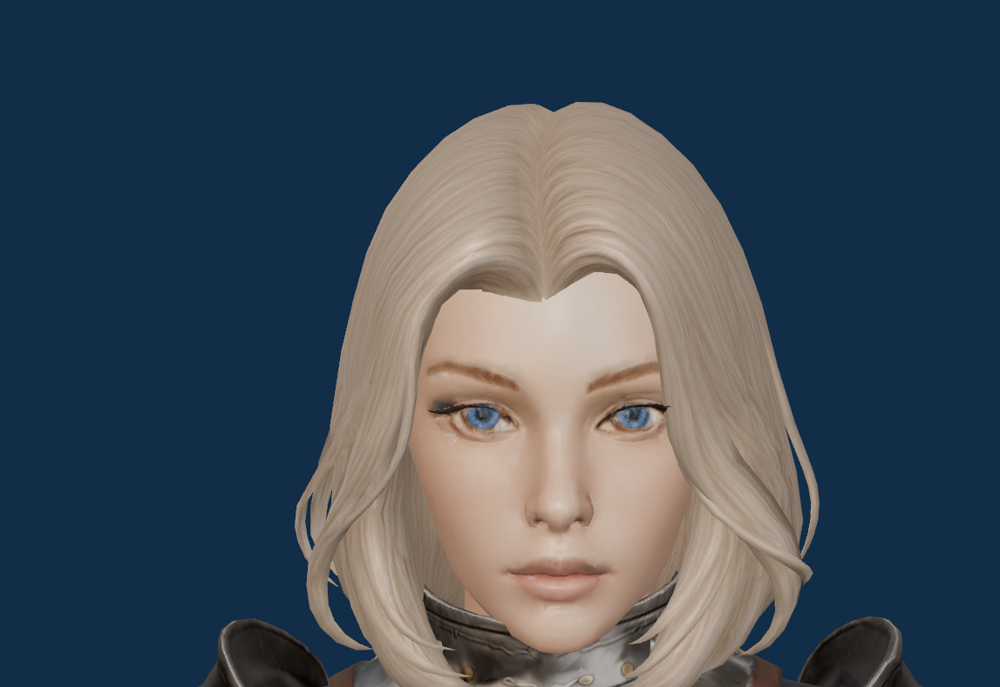
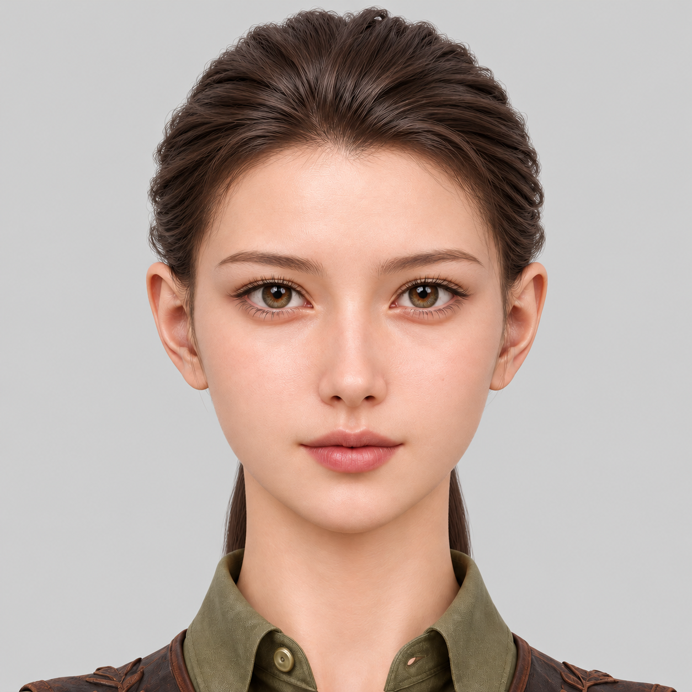
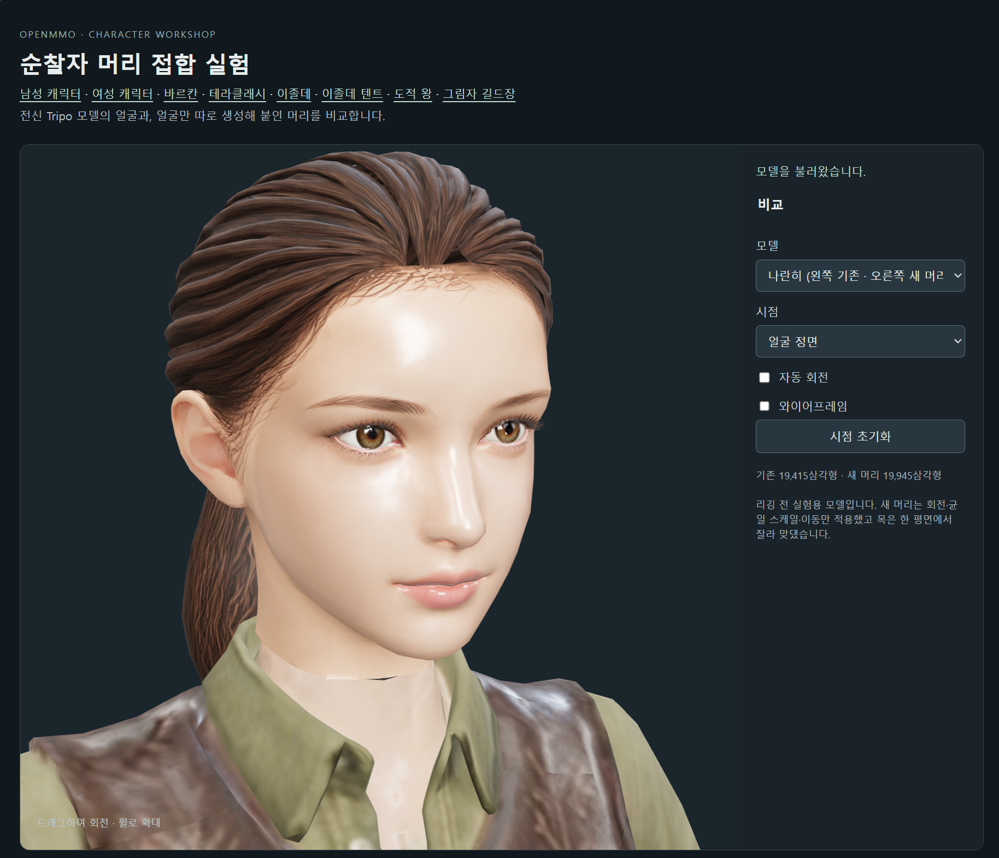
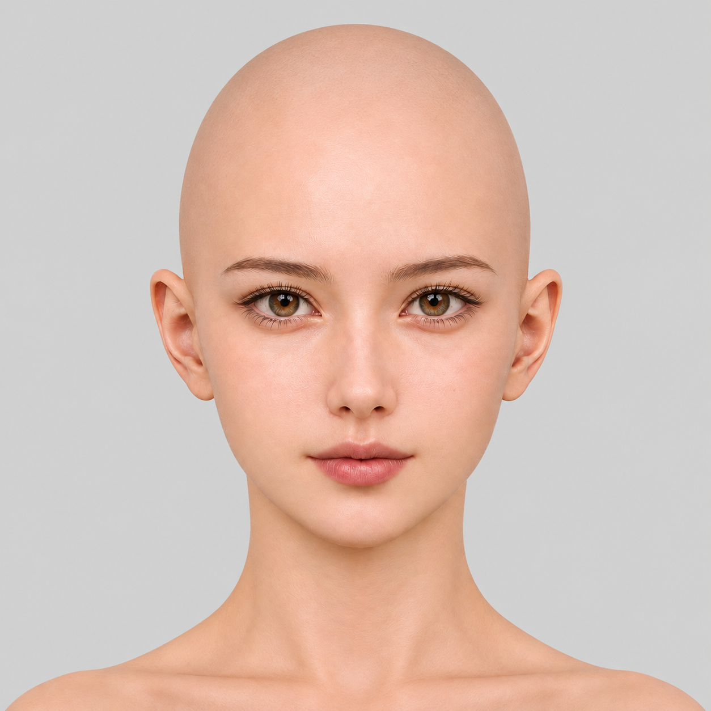
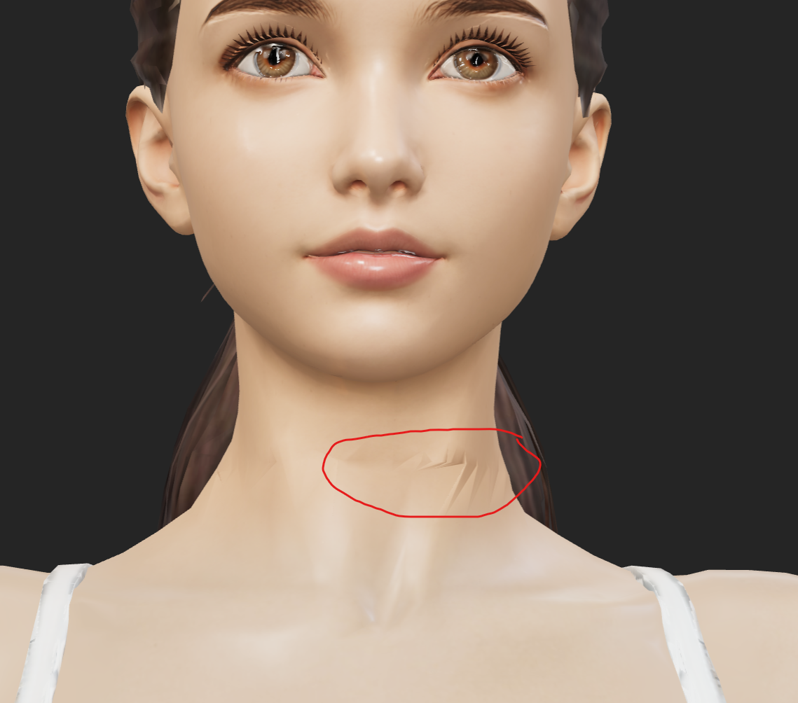
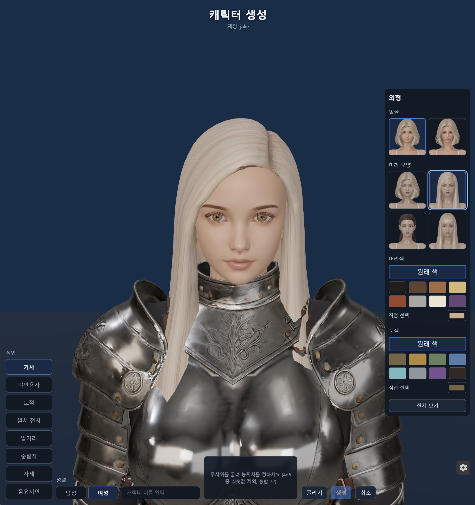
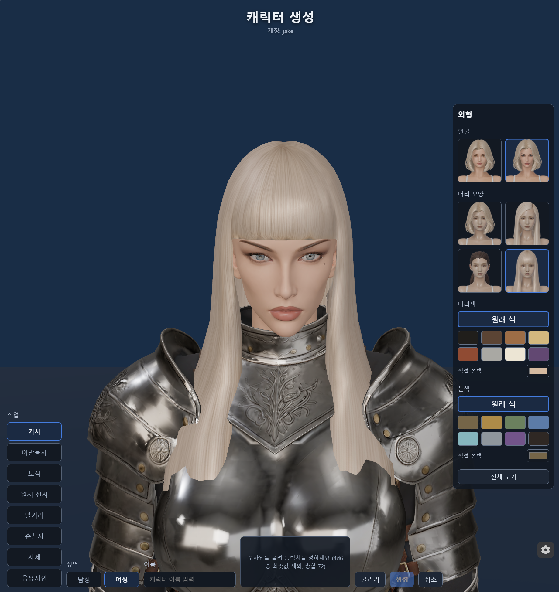

I made a new face for the female character. At first, I extracted the face from a full-body model generated with a higher polygon count. Later, I generated just the head from concept art showing the face at a larger scale. I preferred this result.

## Extracting the Face from a Full-Body Model

The existing female character had 20,000 polygons across the full body. I thought extracting just the face from a model with twice the polygon count might improve the face quality. So I generated a new full-body model with 40,000 polygons. I kept the existing body and equipment, extracted the face from the new model, and attached it to the existing body.

Attaching it to the existing character worked. However, the face was not as pretty as I had hoped, so I was still dissatisfied with the appearance.

## Generating Just the Head from a Larger Face Reference

While discussing the workflow with the newly released Fable 5.2, I received another suggestion: give Tripo concept art showing the face at a larger scale and generate just the head instead of the whole body.

The face occupies a small part of full-body concept art. I narrowed the part being generated by using a close-up drawing of the face.

First, I drew the female ranger's face in close-up. Below is the face concept art made during that process.

Before making the face for the game, I tested whether this method would improve the quality. I generated a head with hair attached and temporarily joined it to the existing ranger's body. Below is the result of that experiment. The cut boundary at the neck is still visible because the connection had not yet been refined.

In the experiment, the eye textures and pupils came out cleanly, and the eyelashes were modeled with clear separation from the surrounding areas. In the previous work, cleaning up the eye area, refining the textures, and separating the eyelashes took considerable time and effort. This time, the eyes and eyelashes needed almost no fine adjustments, making the first result usable.

The experiment went well, so I proceeded with making the head for the game. Since hair is a separate part that can be swapped in the game, I prepared a version of the same face with the hair and clothing removed. I used this image to generate the head again, this time without hair.

## Attaching It to the Existing Body and Checking the Result

Attaching the generated head to the existing female body left a very visible seam at the neck. Below is an intermediate state with angular marks remaining around the connection.

I reviewed the results with Fable 5.2 and repeated the adjustments several times, resolving these connection issues.

I used about 7,000 polygons to generate the face. The face already accounted for a substantial number of polygons in the existing full-body model, so the total polygon count increased by about 2,000 after the work was complete. Most of the quality improvement was in the texture. Generating just a small area such as the face from a larger reference produced a prettier texture.

## The Result in the Game and New Hairstyles

I added the finished face to the game. Below is the final result in the character creation screen. The face looks much better than the previous character's.

I also added two hairstyles while working on the face: long straight hair with a side part and long straight hair with bangs. The two screenshots below show different faces paired with the new hairstyles.

## Conclusion

To make a prettier face, generate it separately and join it carefully to the existing body. Fable 5.2 did a good job of fitting the neck connection.

[Sign up for Tripo through this link to receive a discount.](https://studio.tripo3d.ai/?utm_source=creator_invite&utm_medium=linkcopy&utm_campaign=referral_landing_page&invite_code=W0EX4I&uid=8878291)

[You can play OpenMMO here.](https://openmmo.to.nexus)

The prompts, intermediate concept art, and other production materials used for this work are available in the [OpenMMO GitHub repository](https://github.com/Julian-adv/OpenMMO).

[Tripo Official KakaoTalk Open Chat](https://open.kakao.com/o/p9QNacSi)

[Tripo Official Naver Cafe](https://cafe.naver.com/tripokorea)
