[In the previous post, “Making Valkyrie Equipment with Tripo Segment,”](/blog/valkyrie-armor-segmentation/) I introduced the process of splitting a complete Valkyrie model to make bracers, boots, and a helmet. Fitting and rigging were easier than making each piece of equipment separately and adjusting it to the body.

[When I first built modular characters](/blog/modular-characters/), I created separate concept art and 3D models for each piece of equipment and attached them to a base character. Fitting sleeves, shoulders, and ankles to the body took a lot of time. Even after adjusting the size, skin would poke through clothing or equipment would bend awkwardly during movement. Astra or Sol would fix the fitting and rigging, but similar work had to be repeated whenever I added more equipment.

This post is a detailed follow-up to the Valkyrie work. Using a female bard outfit as an example, it covers concept preparation, model generation and splitting, fitting, and rigging so that the same method can be applied to other characters and outfits. The goal is to build a modular character that can change outfits by swapping tops, bottoms, gloves, boots, and other parts.

## 1. Create the Base Character

The first step is to create the base character. This body serves as the reference for fitting clothing and equipment, and it is also what will appear when the equipment is removed.

Start by establishing the base's build, body proportions, and the default positions of the arms and legs. Clothing made afterward is adjusted in size and shape to fit this body. If the reference keeps changing, equipment already made will need to be adjusted again, so it helps to settle on the body before making the clothes.

Below is a screenshot of the female base in the character preview with hair and equipment hidden. She is wearing only the basic top and bottoms and standing in an A-pose with her arms angled outward, making it easy to see her proportions and the positions of her arms and legs.

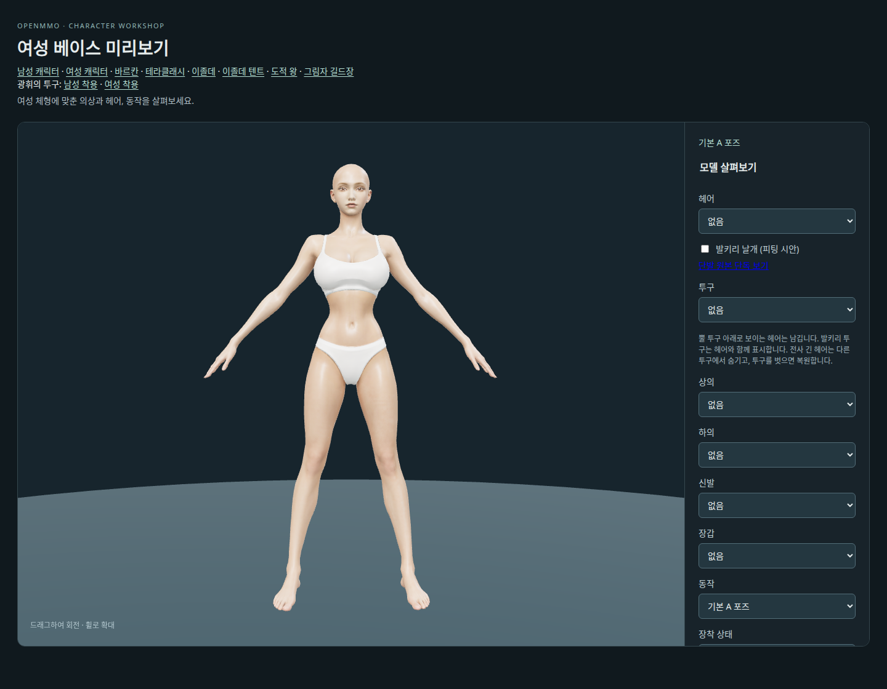

The details of creating the base are recorded in [“Making a Female Character Modular.”](/blog/modular-female-character/) Here, I will continue with making interchangeable outfits for the prepared base.

## 2. Draw the Outfit Concept

Once the base character is ready, draw the concept art for the outfit. First, establish the overall shape, colors, and combination of materials by showing the character wearing the full outfit and equipment.

For this bard outfit, I used existing concept art as a reference. The female bard below is wearing pants. I wanted to carry over the designs of the green cape, striped sleeves, brown leather corset and belts, and boots.

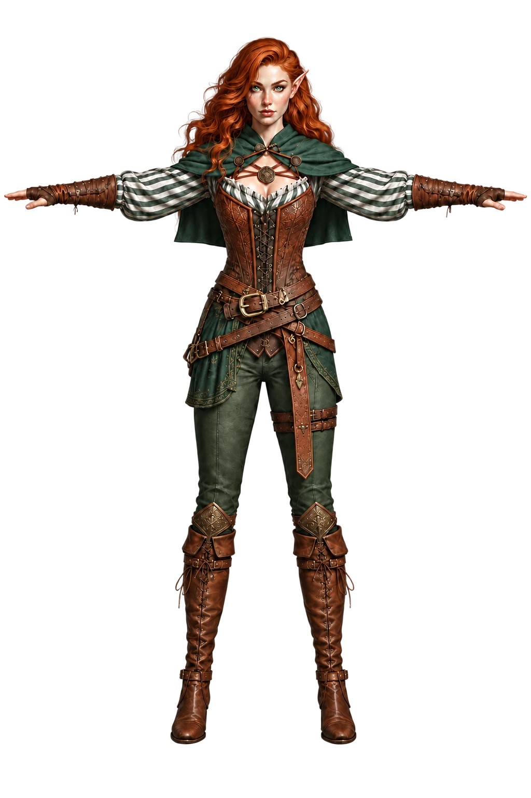

## 3. Draw the Concept to Match the Base

Once the outfit design is decided, draw it to match the base's body shape and pose. **The image below is a Blender render of the actual base character's 3D model.** Prepare the reference image by rendering the actual base model in Blender or in the game. Since I planned to make high-heeled boots, I also adjusted the feet to the angle used when wearing heels.

The concept art used to create the base and the finished 3D model can differ in proportions and shape. That is why it is important to **draw the outfit directly over a render of the finished base model, matching its proportions.** Using the body that will actually wear the outfit as the reference helps the mesh generated from the concept fit the base better and reduces the adjustments needed during fitting.

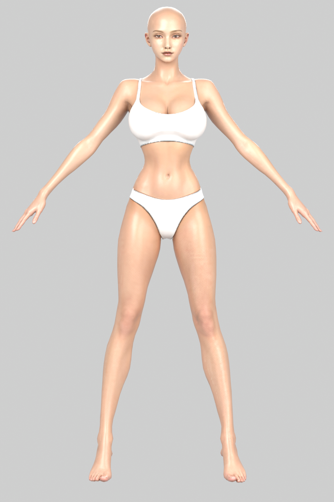

I asked Codex to draw the clothing as if dressing this body, preserving the base's shoulder width, waist and hip proportions, arm angles, leg length, and foot positions. I also asked it to replace the original pants with a short skirt. The intention was to match the concept to the base from the start and reduce the work of adjusting the body shape after generating the model.

The result is the skirt version below: concept art of the bard outfit matched to the base's proportions and A-pose.

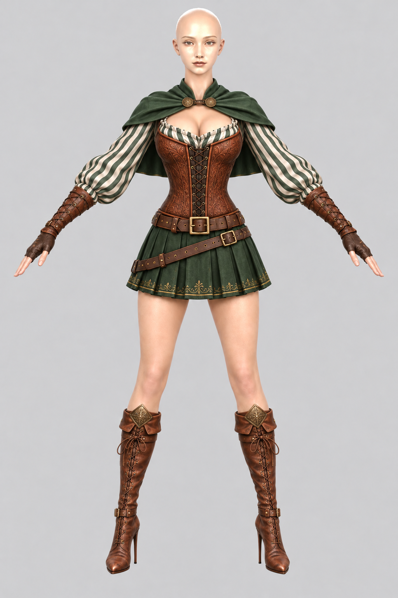

Compare the finished concept against the base by overlaying them. In the image below, the left side shows the skirt concept, while the right side blends the concept and base at 50% each. Comparing the hands, knees, and feet shows how closely the drawing matches the base's proportions and pose.

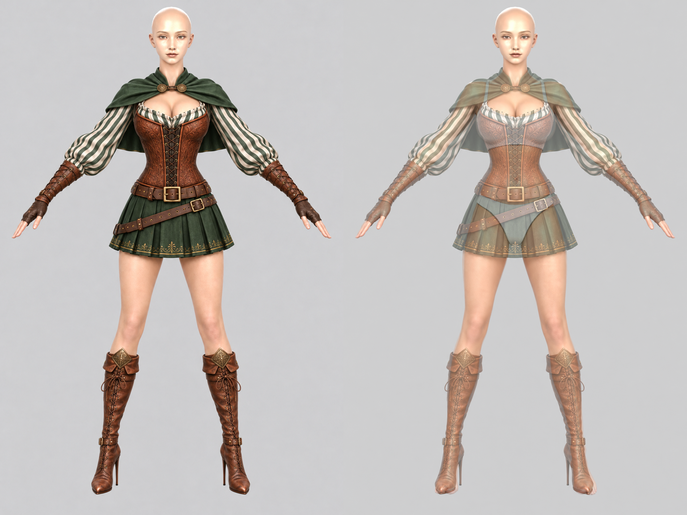

**The key at this stage is to make the body's silhouette and pose match as closely as possible when the concept is overlaid on the base.** If the shoulder and hip widths, limb lengths, or hand and foot positions are already off in the concept, those differences will have to be corrected through fitting after modeling. Matching the concept closely to the base from the start reduces misalignment in the generated model and makes fitting much easier.

If something does not line up in the overlay, point it out specifically to Codex and ask it to revise it. If the arm angles differ, ask it to match the base's arms. If the legs have become shorter or the feet have spread apart, ask it to match the knee and toe positions. Overlay each revision again and repeat until the silhouettes line up well.

## 4. Give Tripo the Concept and Generate a Model

I uploaded the concept matched to the base to Tripo and generated a 3D model. I set the triangle count to about 20,000. It does a good job even with just one front-view concept image. Below is the model generated from the bard concept.

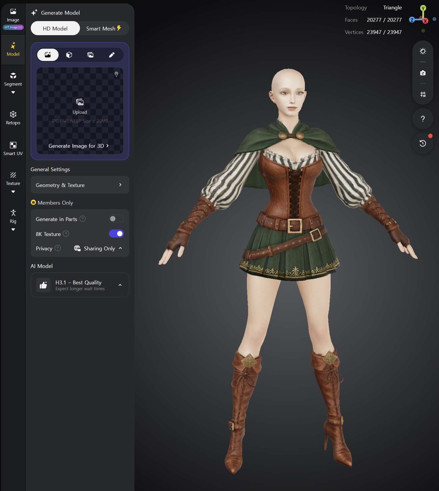

Once modeling is complete, texture the model. Then click **PBR** on the left and run **Generate PBR** once as well to create the PBR textures.

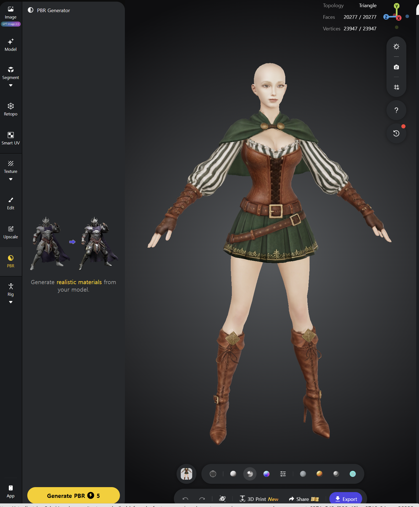

## 5. Split the Outfit with Segmentation

Once the textures are ready, split the model in the **Segment** menu. The task is to organize the resulting pieces into the outfit parts that will actually be swapped.

The parts needed are the top, bottoms (pants or a skirt), left boot, right boot, left glove, and right glove. If there is a helmet or hair, organize those into separate parts too.

Combine pieces that will be used together with **Merge**. Click one part first, then **hold Ctrl and click other parts** to add them to the selection. Click Merge to combine them into one part.

The tool can occasionally malfunction during editing, so it is a good idea to click **Save** frequently as you work.

In the screenshot below, the thighs have different colors, indicating that they are separate parts. As an example of using Merge, **click the thigh on the left side of the screen, then hold Ctrl and click the thigh on the right**, and click **Merge** to combine the two parts.

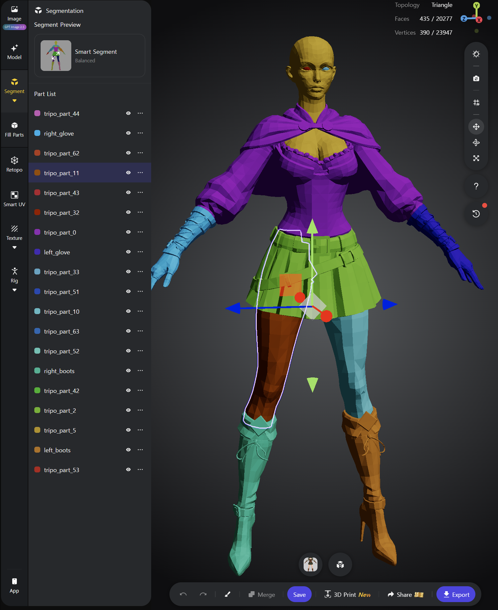

Rename the merged parts as well. In the example above, I named them `left_boots`, `right_boots`, `left_glove`, and `right_glove` so the body part is easy to identify. This makes it easier to specify which part to work on when handing the model to Claude or Codex later.

If the model was not split along the boundaries you wanted, Merge alone may be insufficient. In that case, click the **paintbrush icon** at the bottom and use the brush to adjust the part boundaries.

For example, if an area that should belong to the glove is part of something else, **use the eyedropper to select the glove part's color**, then paint over that area with the brush. The painted area becomes part of the glove. The colors here identify the parts.

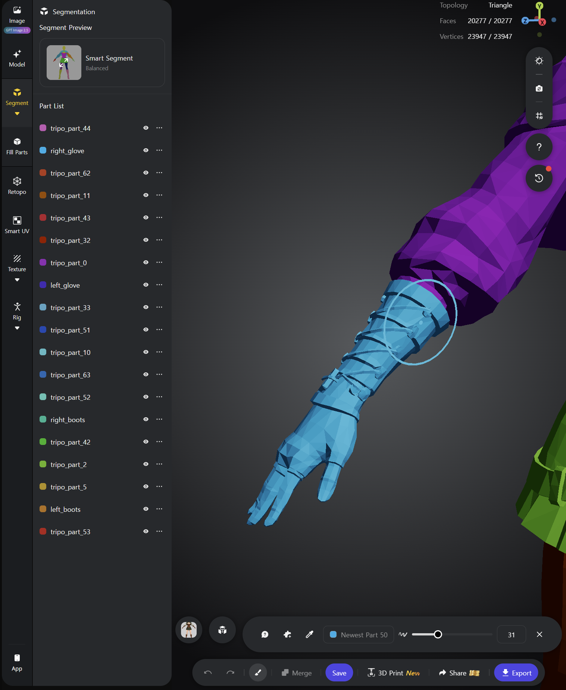

Once the pieces are organized into the outfit parts you want, click **Save** one final time. After saving, merged parts appear in the same color, letting you check which areas have been grouped together.

## 6. Export as GLB, Then Fit and Rig

Once the parts are organized, use **Export** to export the model as **GLB**. Give the downloaded file to Claude and ask it to fit and rig the parts to the existing base character.

Extract only the outfit parts needed from the GLB, such as the top, skirt, boots, and gloves, and place them over the existing base model. Fitting means adjusting each part's size, position, and shape to the base. Rigging means connecting it so that it moves with the base's skeleton.

Cut away the areas of the base body covered by clothing from the mesh used for the equipped outfit, or hide them so they are not rendered. Keep the original base so the body can be shown again when the clothing is removed. Once the outfit parts fit the base and the covered body areas are handled, the basic assembly is complete.

Below is a preview of the bard outfit fitted to the female base.

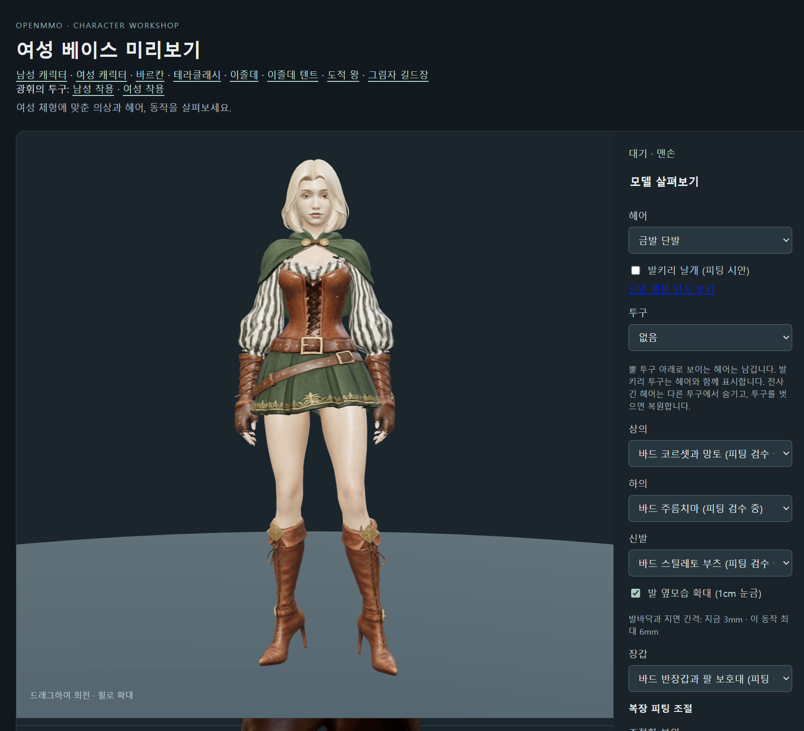

OpenMMO uses an isometric view, so characters are never shown this large and small misalignments are hard to notice in the actual game. Zooming in often reveals uneven or slightly misaligned joins between sleeves and gloves or legs and boots, which need fine adjustments.

I added adjustment controls to the character preview program for this work. They let me adjust each part's position and overall size, width, height, depth, rotation, and tilt to align the joins.

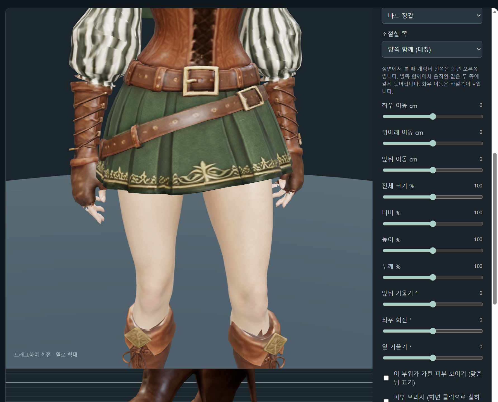

[Sign up for Tripo through this link to receive a discount.](https://studio.tripo3d.ai/?utm_source=creator_invite&utm_medium=linkcopy&utm_campaign=referral_landing_page&invite_code=W0EX4I&uid=8878291)

[You can play OpenMMO here.](https://openmmo.to.nexus)

The prompts, intermediate concept art, and other production materials used for this work are available in the [OpenMMO GitHub repository](https://github.com/Julian-adv/OpenMMO).

[Tripo Official KakaoTalk Open Chat](https://open.kakao.com/o/p9QNacSi)

[Tripo Official Naver Cafe](https://cafe.naver.com/tripokorea)
