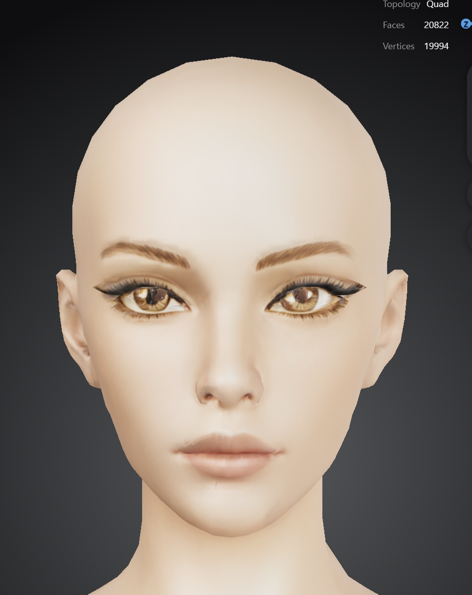
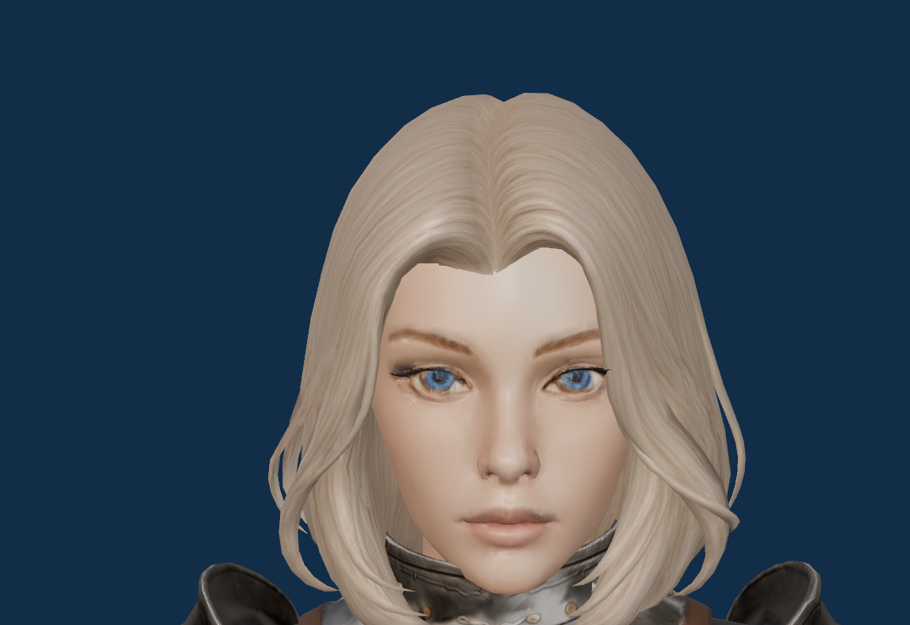
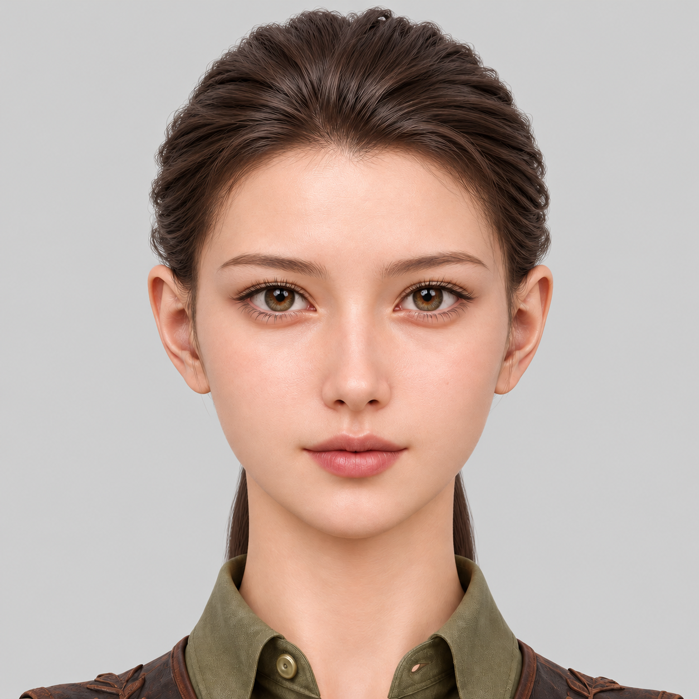
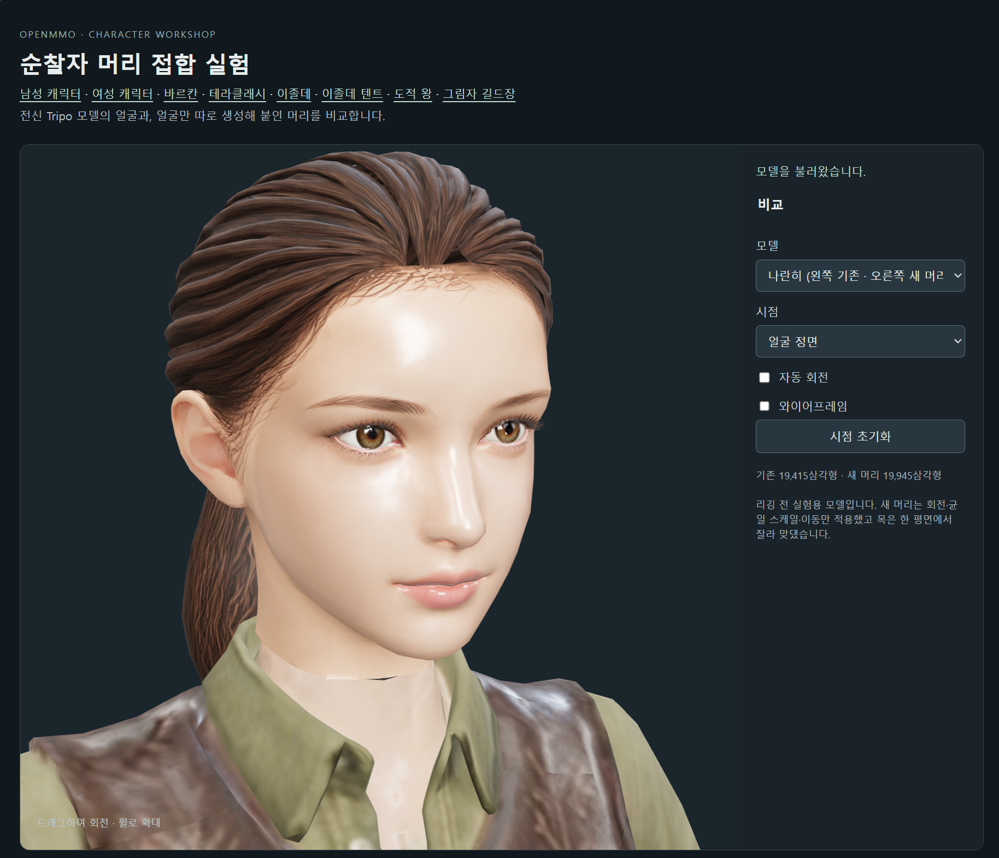
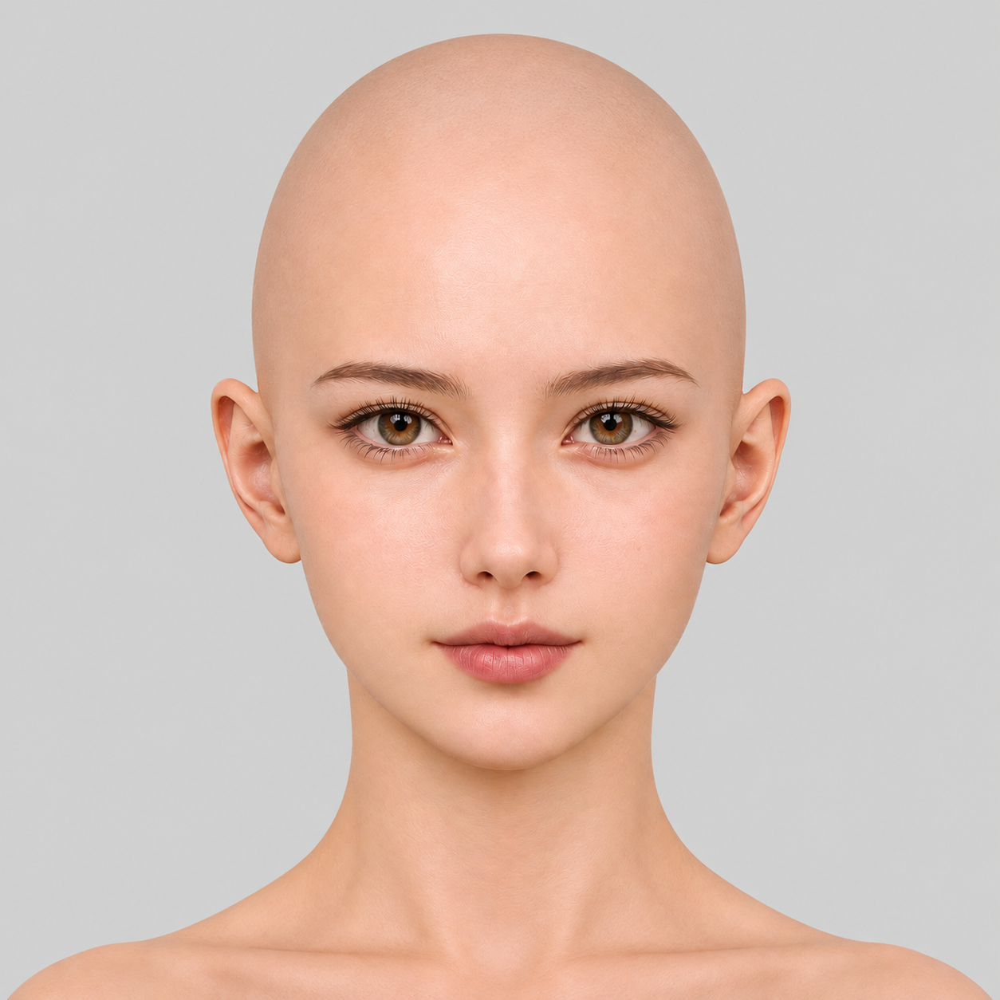
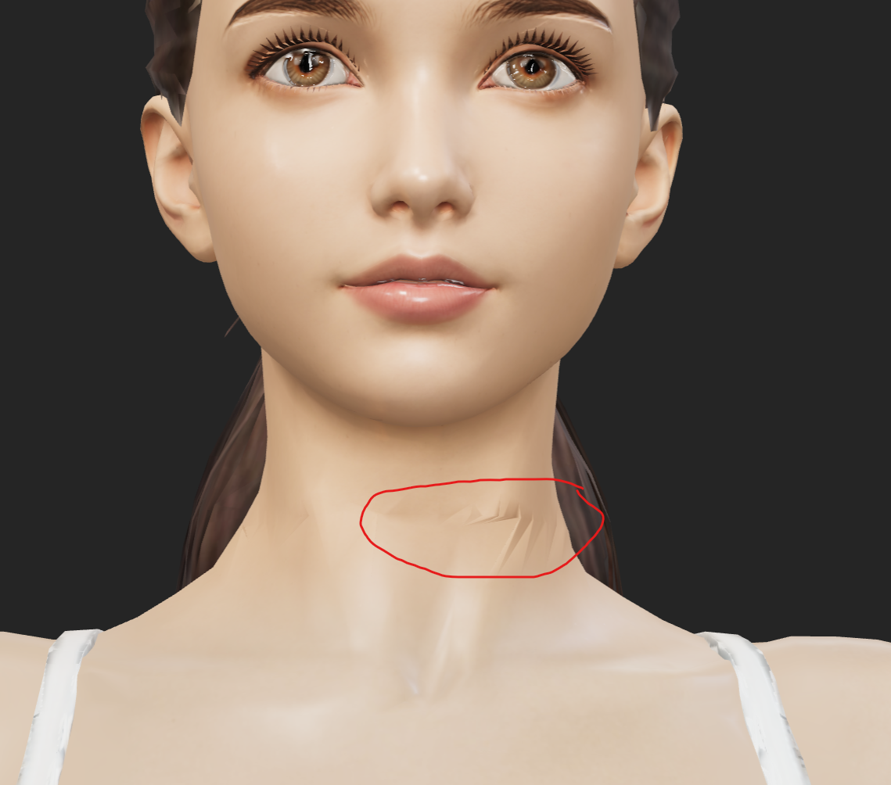
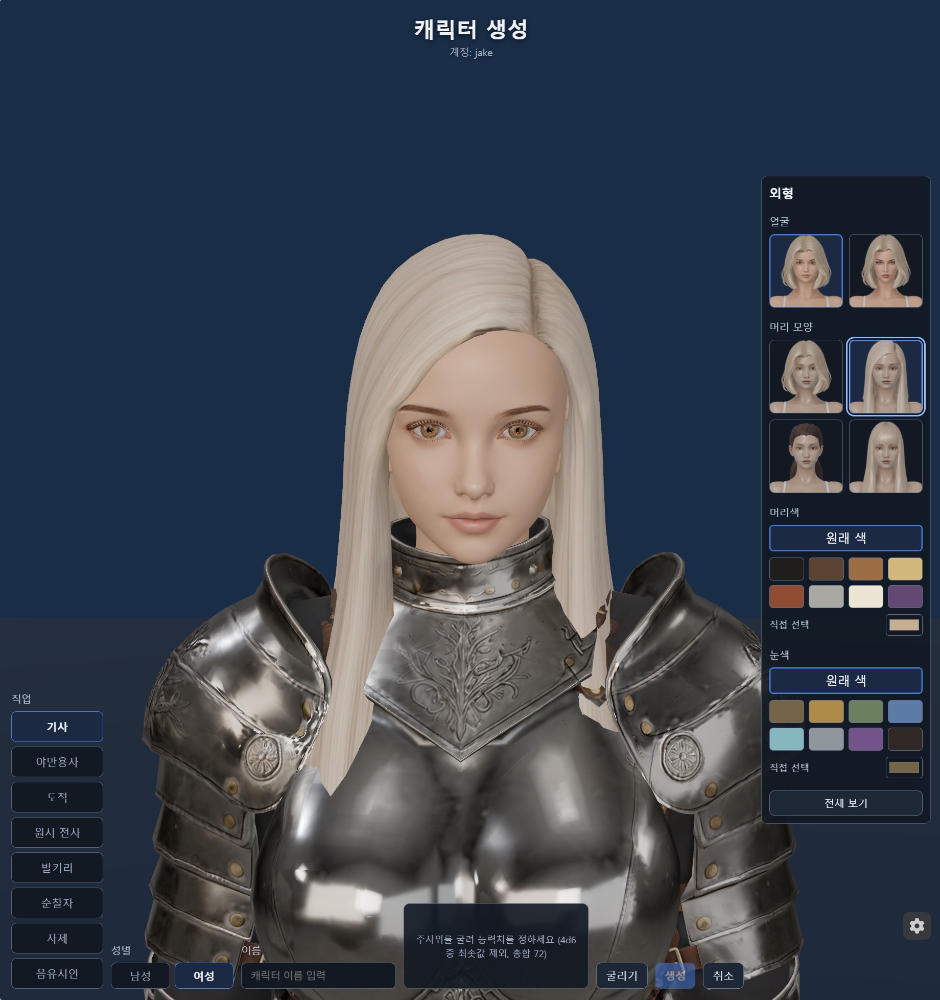
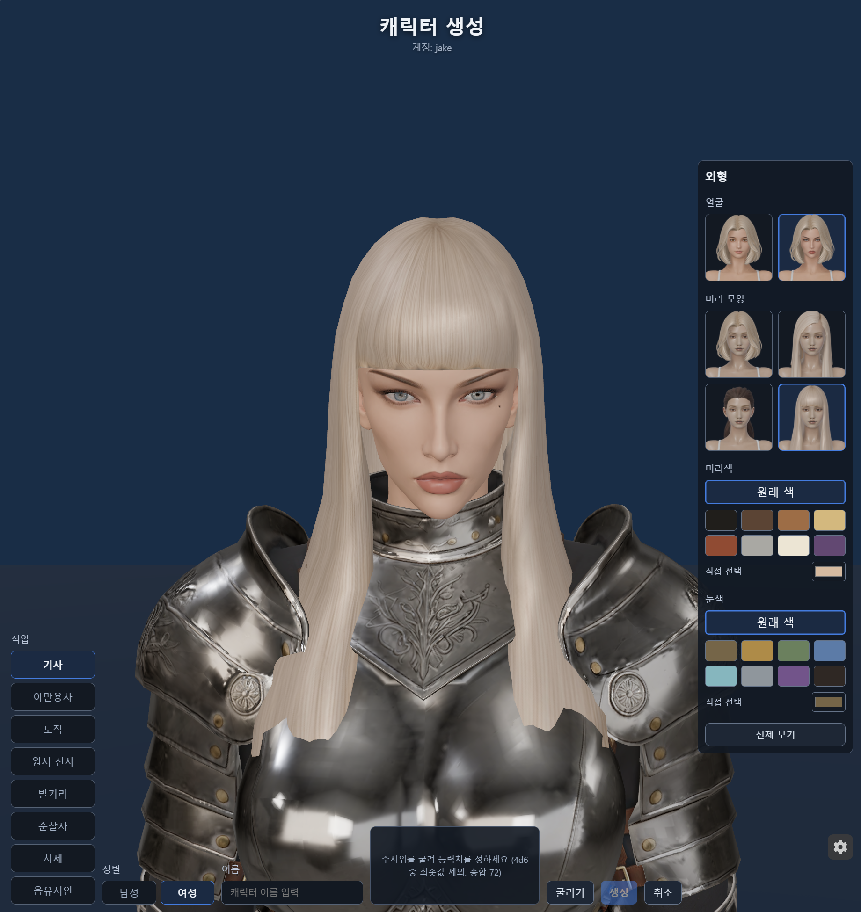

여성 캐릭터의 얼굴을 새로 만들었습니다. 처음에는 폴리곤 수를 높여 만든 전신 모델에서 얼굴을 떼어 썼습니다. 이후에는 얼굴을 크게 그린 원화로 두상만 따로 생성했고, 이쪽 결과가 더 마음에 들었습니다.

## 전신 모델에서 얼굴 떼어 쓰기

기존 여성 캐릭터는 전신 기준 20,000폴리곤이었습니다. 폴리곤 수를 두 배로 늘린 모델에서 얼굴만 떼어 쓰면 얼굴 품질도 높아지지 않을까 생각했습니다. 그래서 40,000폴리곤짜리 전신 모델을 새로 만들었습니다. 몸체와 장비는 그대로 두고, 새 모델에서 얼굴만 떼어 기존 몸체에 붙였습니다.

기존 캐릭터에 붙이는 작업은 잘 됐습니다. 다만 얼굴이 생각만큼 예쁘게 나오지 않아 외형에는 아쉬움이 남았습니다.

## 얼굴을 크게 그려 두상만 생성하기

새로 나온 Fable 5.2와 작업 방법을 이야기하다가 다른 방법을 제안받았습니다. 얼굴이 크게 보이는 원화를 트리포(Tripo)에 주고, 전신 대신 두상만 따로 생성해 보자는 것이었습니다.

전신 원화에서는 얼굴이 차지하는 면적이 작습니다. 얼굴을 크게 그린 원화로 생성할 부위를 좁혀 봤습니다.

먼저 여성 순찰자의 얼굴을 클로즈업으로 그렸습니다. 아래는 그 과정에서 만든 얼굴 원화입니다.

본격적으로 게임용 얼굴을 만들기 전에, 이 방법으로 품질이 좋아지는지 먼저 시험했습니다. 머리카락이 붙은 두상을 생성해 기존 순찰자의 몸체에 임시로 붙였습니다. 아래는 그 실험 결과입니다. 목의 연결 부위를 다듬기 전이라 잘라 붙인 경계가 그대로 보입니다.

실험 결과, 안구의 텍스처와 동공 표현이 말끔했고 속눈썹도 주변과 잘 분리되어 모델링됐습니다. 이전 작업에서는 눈 주변을 정리하고 텍스처를 다듬고 속눈썹을 분리하는 데 많은 시간과 노력이 들었습니다. 이번에는 눈과 속눈썹을 미세 조정할 필요가 거의 없어 첫 결과부터 쓸 만했습니다.

실험 결과가 좋아 게임용 두상 제작을 진행했습니다. 게임에서는 헤어를 별도 파트로 교체하므로, 같은 얼굴에서 머리카락과 옷을 지운 원화를 준비했습니다. 이 이미지로 민머리 두상을 다시 생성했습니다.

## 기존 몸체에 붙여 결과 확인하기

생성한 두상을 기존 여성 몸체에 붙이는 과정에서는 목의 이음매가 심하게 드러나는 문제가 있었습니다. 아래는 연결 부위에 각진 자국이 남아 있던 중간 상태입니다.

Fable 5.2와 결과를 확인하며 몇 차례 수정을 반복했고, 이런 연결 문제들을 해결했습니다.

얼굴 생성에는 약 7,000폴리곤을 사용했습니다. 기존 전신 모델에서도 얼굴에 쓰인 폴리곤이 꽤 많아, 작업을 마친 뒤 전체 폴리곤 수는 약 2,000개 늘었습니다. 품질이 좋아진 부분은 주로 텍스처였습니다. 얼굴처럼 좁은 부위만 크게 그려 생성하니 텍스처가 더 예쁘게 나왔습니다.

## 게임에 적용한 모습과 새 헤어스타일

완성한 얼굴을 게임에 적용했습니다. 아래는 캐릭터 생성 화면에서 확인한 최종 모습입니다. 예전 캐릭터와 비교하면 얼굴의 외형이 많이 좋아졌습니다.

얼굴 작업과 함께 헤어스타일도 두 개 추가했습니다. 옆으로 가르마를 탄 긴 생머리와 앞머리가 있는 긴 생머리입니다. 아래 두 스크린샷은 각각 다른 얼굴과 새 헤어스타일을 선택한 모습입니다.

## 결론

얼굴을 예쁘게 만들려면 얼굴만 따로 생성해 기존 몸체에 잘 이어 붙이면 됩니다. 목의 연결 부위를 맞추는 작업은 Fable 5.2가 잘 해줬습니다.

[이 링크를 눌러 트리포에 가입하시면 할인을 받을 수 있습니다.](https://studio.tripo3d.ai/?utm_source=creator_invite&utm_medium=linkcopy&utm_campaign=referral_landing_page&invite_code=W0EX4I&uid=8878291)

[OpenMMO에서 직접 플레이해 볼 수 있습니다.](https://openmmo.to.nexus)

이 작업에 사용한 프롬프트와 중간 단계 원화 등 제작 자료는 [OpenMMO GitHub 저장소](https://github.com/Julian-adv/OpenMMO)에서 볼 수 있습니다.

[Tripo 공식 카카오톡 오픈채팅방](https://open.kakao.com/o/p9QNacSi)

[Tripo 공식 네이버 카페](https://cafe.naver.com/tripokorea)
