[이전 작업](/blog/modular-characters/)에서는 남성 캐릭터를 부위별로 조립하는 모듈형으로 만들었습니다. 이번에는 여성 베이스의 얼굴과 리깅, 동작을 다듬고 단발 헤어와 투구·상의·하의·장갑·부츠를 각각 제작했습니다. 완성한 베이스와 장비는 여성 기사 캐릭터가 사용하도록 게임에 연결했습니다.

## 여성 베이스 만들기

기준 원화는 제가 ComfyUI에서 Qwen Image 2.1로 만든 정면과 측면 이미지입니다. 머리카락은 교체할 수 있도록 별도 파트로 만들기 때문에, 베이스는 머리카락 없는 두상을 기준으로 했습니다.

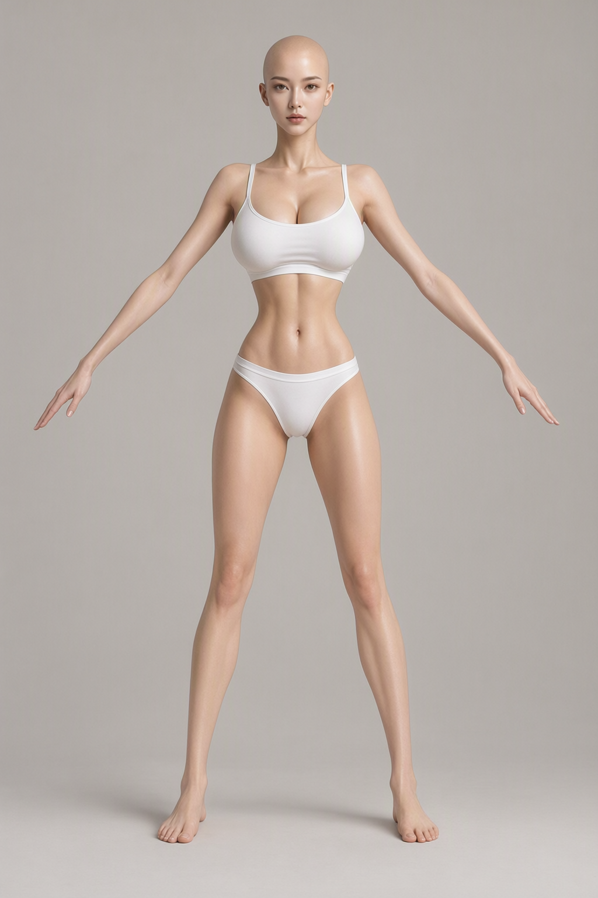

Meshy에서도 베이스 모델을 만들었지만 결과가 마음에 들지 않아 폐기했습니다. 이후 Tripo API로 베이스를 제작했습니다.

Tripo에 정면과 측면을 함께 넣은 요청은 서비스의 콘텐츠 정책 오류로 거절됐습니다. 이후 정면 한 장만 넣고 20,000삼각형을 목표로 생성한 요청은 성공했고, 실제 결과는 20,927삼각형이었습니다.

아래는 Tripo에서 생성한 베이스의 최초 상태입니다. 아직 얼굴 보정과 리깅을 적용하기 전의 모습입니다.

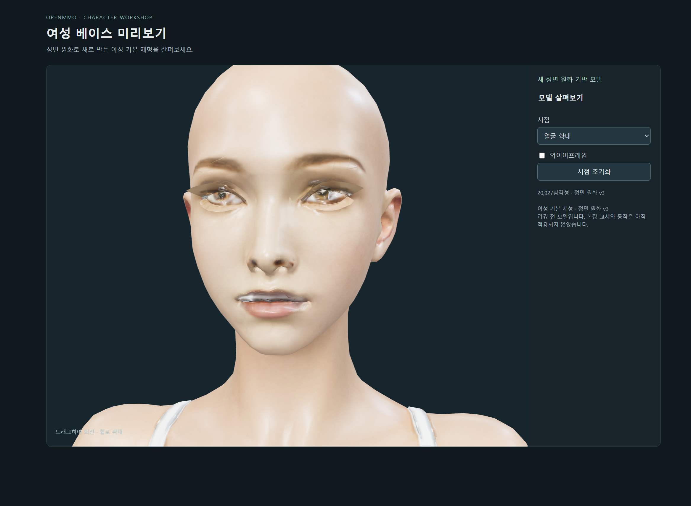

생성된 모델은 바로 사용할 수 있는 상태는 아니었습니다. 얼굴을 확대해 보니 눈 주변과 속눈썹, 입술과 귀 안쪽에 손볼 부분이 있었습니다.

### 속눈썹과 눈 주변 정리

속눈썹은 처음에 불투명한 평면처럼 보였습니다. 먼저 이 평면에 알파 마스크를 적용해 속눈썹 사이의 배경을 투명하게 만들었습니다. 아래는 그 상태를 확대한 모습입니다. 각 가닥을 따로 모델링한 것이 아니라, 평면 위의 텍스처와 투명도로 속눈썹 모양을 표현한 단계입니다.

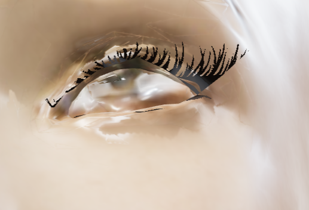

이 상태에서도 뭉쳐 보이는 표현이 남아 속눈썹을 가늘고 끝이 좁아지는 곡선 가닥으로 바꿨습니다. 각 가닥의 뿌리를 눈꺼풀에 맞추고 길이를 조정했습니다. 아래는 가닥별 모델링과 눈 주변 텍스처 정리를 마친 상태입니다.

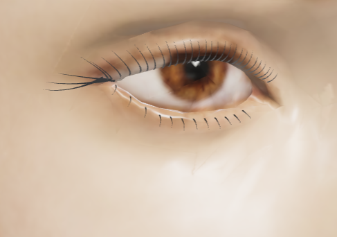

가닥을 너무 가늘게 만들면 얼굴 전체를 보는 거리에서는 속눈썹이 잘 보이지 않았습니다. 뿌리와 중간 부분의 두께를 보강하고 끝은 가늘게 유지했습니다. 아래는 속눈썹이 더 잘 드러나도록 두께를 조정한 상태입니다.

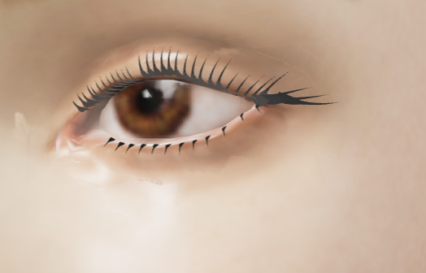

### 피부의 반사와 입술 정리

눈 아래에는 뾰족한 삼각형 형태의 잘못된 반사도 보였습니다. 아래는 그 문제가 남아 있는 상태입니다.

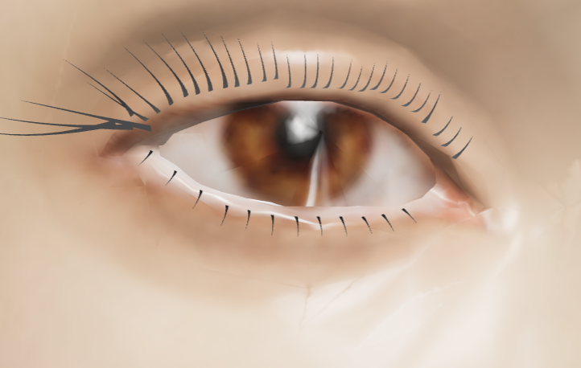

이 반사는 정점의 노멀 방향이 주변과 달라 생긴 문제였습니다. 노멀은 표면이 어느 방향을 향하는지 나타내며 빛의 반사에 영향을 줍니다. 해당 정점의 방향을 주변과 맞춰 반사를 바로잡았습니다.

눈썹 주변 피부에도 메시 경계선처럼 보이는 삼각형 자국이 있었습니다. 아래는 피부 표면의 노멀맵 문제로 경계선이 드러난 수정 전 상태입니다.

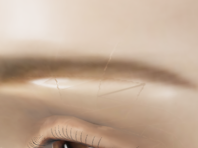

노멀맵은 텍스처로 표면 방향의 세부 변화를 표현해 굴곡이 있는 것처럼 보이게 합니다. 눈썹 주변 자국은 이 노멀맵을 끄면 사라졌습니다. 해당 영역을 국소적으로 보정해 경계선을 줄였고, 귀 안쪽에 보이던 격자형 자국도 같은 방식으로 다듬었습니다.

입술에는 회백색 띠처럼 보이는 어색한 반사가 있었고, 콧구멍의 어두운 텍스처도 실제 구멍 위치에서 벗어나 주변 피부에 걸쳐 있었습니다. 아래는 이 두 문제가 남아 있던 수정 전 상태입니다.

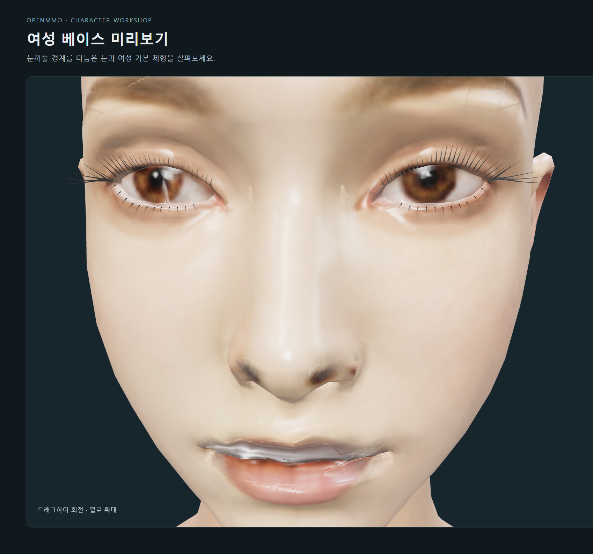

입술은 노멀맵과 광택을 조정해 반사를 부드럽게 만들었습니다. 콧구멍은 어두운 텍스처를 안쪽에 맞추고 주변 피부에 남은 얼룩과 음영의 강도도 다듬었습니다.

각 부분을 수정한 뒤 얼굴 전체를 확인했습니다. 아래는 얼굴 정리를 마친 상태입니다.

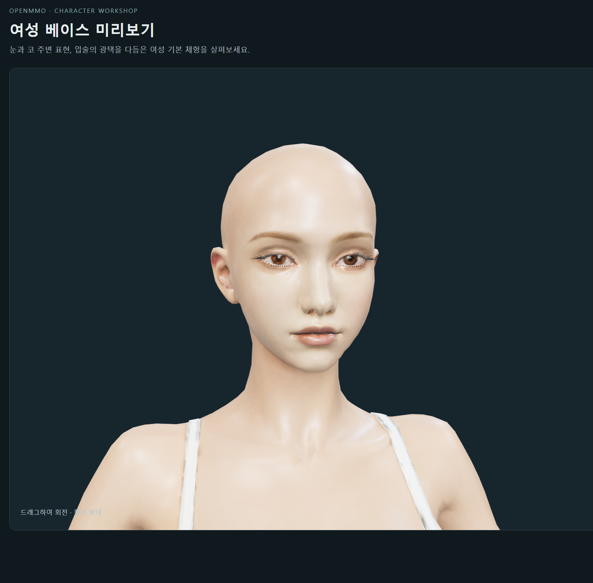

## 여성 체형에 맞춘 리깅과 동작

남성 캐릭터의 본 이름과 계층은 참고하되 여성 몸체의 관절 위치와 본 길이, 기준 자세는 새로 만들었습니다.

**이번 여성 베이스는 Mixamo를 거치지 않고 아스트라가 Blender를 이용해 스스로 리깅했습니다.** 제가 모델을 업로드하고 리깅 결과를 다운로드해 전달할 필요 없이, 아스트라가 본 배치와 가중치 계산까지 수행해 65개 본을 가진 여성 리그를 만들었습니다.

애니메이션은 기존 Mixamo 동작을 여성 리그에 맞춰 옮겼습니다. 대기·걷기·달리기·점프·전투 대기·베기·쓰러지기·앉기를 적용하고, 여성 체형에 맞게 손과 시선, 발의 접지를 보정했습니다.

자동 가중치를 적용한 첫 결과에서는 기본 상의와 피부가 서로 다르게 움직여 피부가 옷을 뚫고 나왔습니다. 상의 표면에 바로 아래 몸체의 가중치를 맞춰 적용해 같은 움직임을 따르도록 보정했습니다.

### 손가락 리깅과 손잡이를 쥐는 자세

손에서도 손가락과 본의 대응이 하나씩 밀려 오른손 검지가 제대로 리깅되지 않은 문제가 있었습니다. 아래는 손가락이 해당 본의 움직임을 제대로 따라가지 못하던 상태에서 뼈대를 표시한 모습입니다.

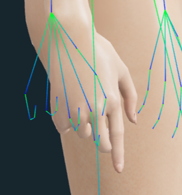

손가락과 본의 대응을 바로잡은 뒤에도 포즈가 잘못돼 손가락이 어색하게 구부러졌습니다. 아래는 리깅을 수정한 직후의 모습입니다.

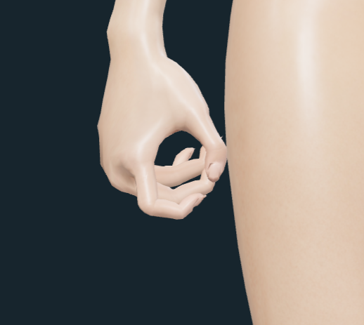

포즈를 다시 조정했지만 손가락은 여전히 어색하게 굽혀져 있었습니다.

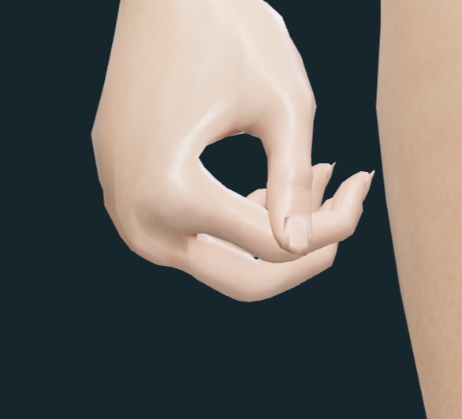

손잡이를 쥐는 자세를 구체적으로 보여 주기 위해 아래 참고 이미지를 아스트라에게 전달했습니다. 손가락이 손잡이를 감싸고 엄지가 다른 손가락 위에 놓이는 모양을 참고해 포즈를 수정하도록 했습니다.

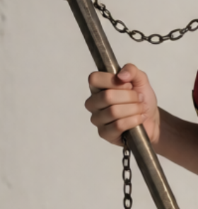

손가락의 포즈를 검 손잡이에 맞춰 잡기 위해, 먼저 검을 오른손에 붙여 봤습니다. 아래는 뼈대를 표시한 채 검과 손의 위치를 확인하던 단계입니다.

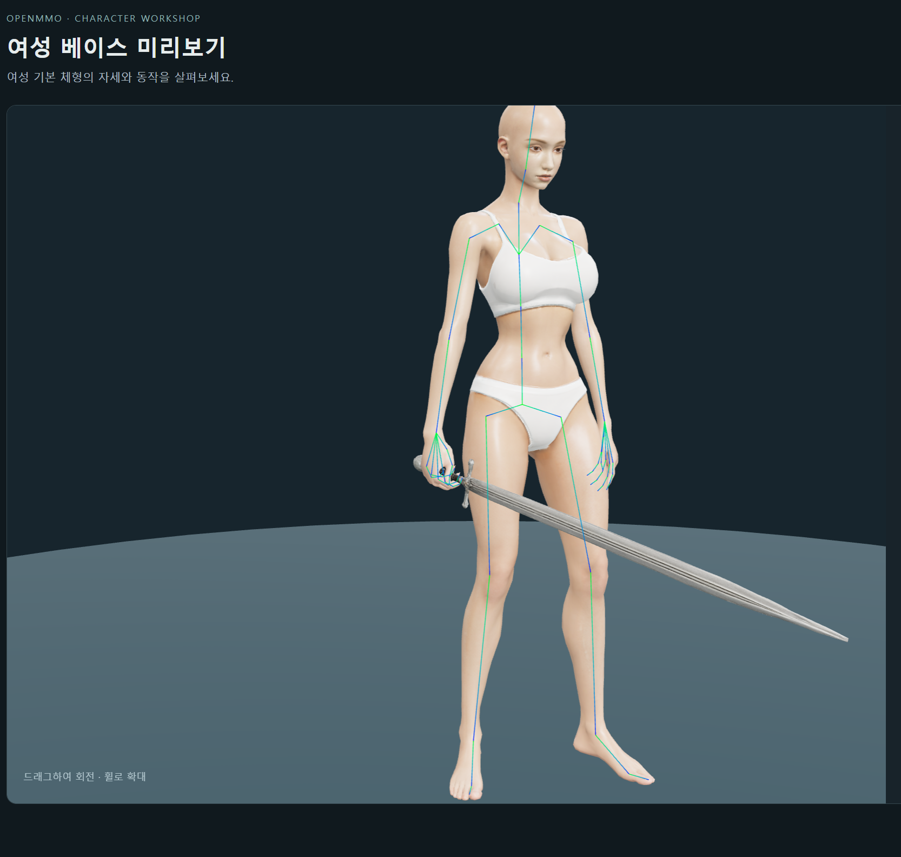

참고 이미지와 실제로 붙인 검을 보면서 손가락의 포즈를 다시 맞추고, 손잡이를 쥐는 자세를 다듬었습니다.

오른손의 검에 이어 왼손의 횃불과 방패도 미리보기에서 맞춰 봤습니다.

아래는 왼손에 횃불을 들게 해 본 초기 상태입니다. 횃불의 위치와 손가락이 잘 맞지 않아 손가락이 손잡이에 파묻혀 있었습니다.

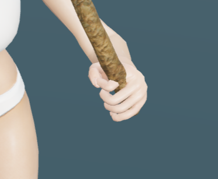

왼손에 방패도 맞춰 봤습니다. 처음에는 손과 방패 손잡이의 위치가 맞지 않아, 방패가 손에서 떨어져 붕 떠 보였습니다. 아래는 위치를 더 조정해야 했던 상태입니다.

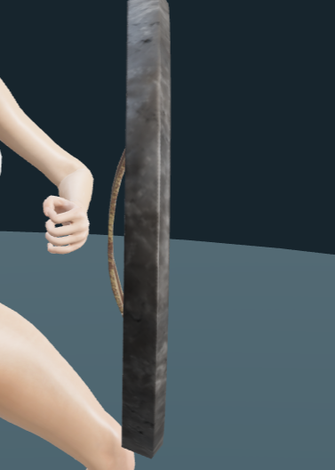

### 걷기와 앉기 자세

걷기는 기존 Mixamo 캣워크 동작을 여성 골격에 맞춰 옮겼습니다. 발을 중앙선 가까이 디디도록 폭을 좁히면서 발바닥이 안쪽으로 기울지 않게 했고, 올라가 보이던 어깨도 낮췄습니다.

앉기는 실제 게임의 의자를 미리보기에 놓고 맞췄습니다. 아래는 자세를 수정하기 전에 처음 의자에 앉혀 본 상태입니다.

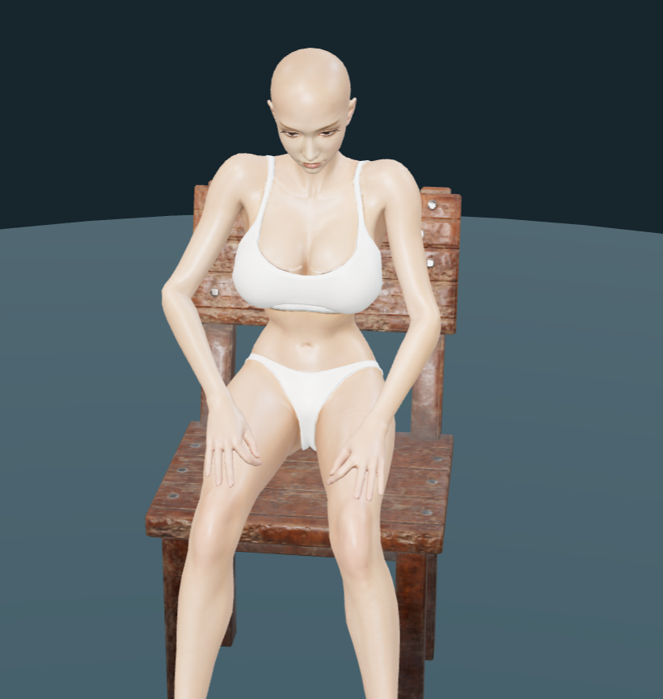

같은 상태를 옆에서 본 모습입니다. 엉덩이가 좌석에서 떠 있어 앉는 높이도 맞춰야 했습니다.

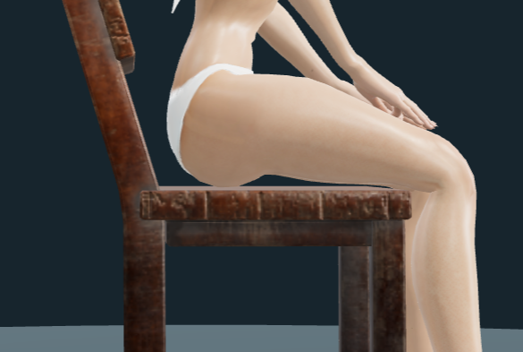

앉는 자세를 다듬는 과정에서는 어깨가 너무 올라가 움츠린 듯 보이는 문제도 있었습니다. 아래는 어깨를 낮추기 전의 상태입니다.

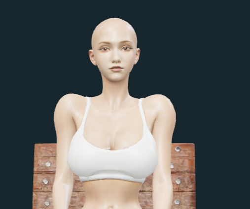

이후 엉덩이를 좌석에 맞추고 발바닥을 바닥에 붙인 뒤, 손이 무릎 안으로 들어가지 않도록 팔과 손의 위치를 조정했습니다. 올라간 어깨도 낮춰 자연스럽게 앉도록 다듬었습니다. 동작을 재생하는 것만으로는 놓치기 쉬운 부분이라 정면·측면·후면에서 시점을 바꾸며 확인했습니다.

## 교체할 수 있는 금발 단발

처음에는 긴 금발 헤어를 제작했지만 추가 작업은 보류하고, 어깨에 닿지 않는 턱 아래 길이의 단발로 진행했습니다. ImageGen으로 정면·측면·후면 원화를 만들고 Tripo에서 헤어 메시를 생성했습니다.

생성된 헤어에는 얼굴 안쪽을 막는 불필요한 면이 있어 정리했습니다. 정수리와 앞머리 비율은 유지하면서 아래쪽 끝을 올리고, 두피가 뚫고 나오는 부분은 위치와 후면 곡면을 조정했습니다. 최종 단발은 2,436삼각형이며 머리 본을 따라 움직입니다.

아래는 여성 베이스에 단발을 맞춰 붙인 렌더입니다.

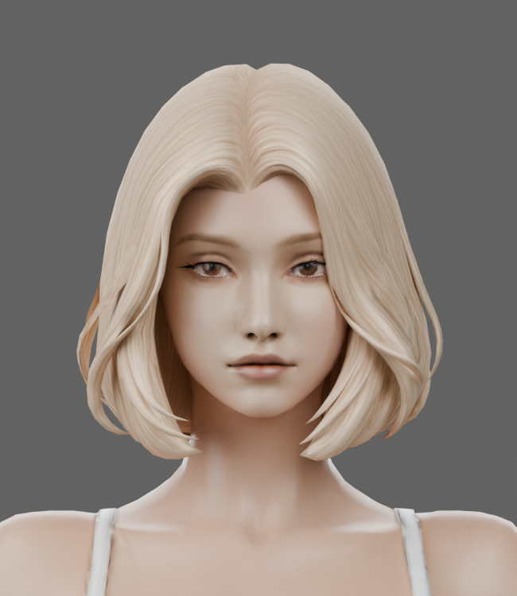

## 기사 상의와 하의

기사 장비도 각 부위를 별도로 만들었습니다. 참고 이미지에서 원하는 형태를 정하고 ImageGen으로 원화를 만든 뒤, Tripo API로 메시를 생성했습니다. 이후에는 여성 베이스에 맞춰 크기와 형태, 리깅을 조정했습니다.

상의는 흉갑과 등판, 목 보호대, 견갑과 소매를 포함합니다. 처음 몸체에 맞추는 피팅에서는 소매가 찌그러지고 판금이 부적절하게 변형됐습니다. 원본에서 피팅과 가중치를 다시 만들고, 흉갑과 견갑의 중심은 형태를 유지하면서 소매는 실제 팔의 움직임을 따라가도록 했습니다.

아래는 판금 상의를 처음 리깅한 상태에서 팔꿈치 쪽을 확대한 모습입니다. 빨간 원으로 표시한 부분에서 소매와 팔이 잘 맞지 않아 어긋나 있었습니다.

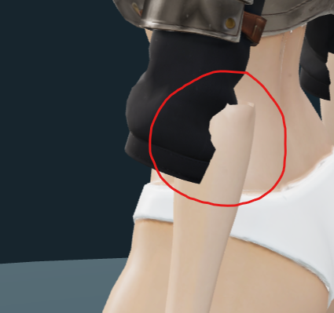

소매 입구가 팔보다 좁거나 중심이 어긋나 피부가 소매 밖으로 나오는 부분이 있었습니다. 입구를 팔 표면에 맞춰 넓히고 끝단을 팔꿈치가 접히는 중심 아래로 내려, 깊게 굽히는 동작에서도 걸리는 부분을 줄였습니다.

하의는 골반과 허벅지 주변의 판금, 앞뒤 가리개와 가죽끈으로 구성했습니다. 아래는 판금 하의를 처음 몸체에 맞춰 본 상태입니다. 빨간 원으로 표시한 허리 옆쪽에서 몸과 갑옷 사이가 너무 벌어져 있었습니다.

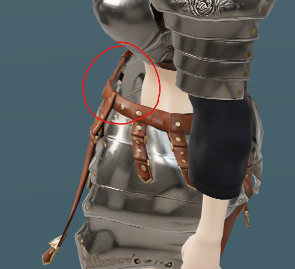

몸체에 맞춰 간격을 조정하면서 판금 가장자리의 곡률을 완만하게 만들고, 가죽끈과 버클의 위치·회전을 맞췄습니다. 부츠를 만든 뒤에는 끈 끝의 클립이 부츠 상단에 붙도록 다시 조정했습니다.

가죽끈의 앞뒷면이 거의 겹쳐 깜박이는 문제도 있었습니다. 겹친 표면의 간격과 노멀을 조정하고, 허리띠에서 버클로 이어지는 구간의 꼬임과 꺾임을 펴는 작업을 반복했습니다.

## 높은 굽의 부츠와 발 자세

부츠는 높은 굽이 있는 판금 디자인으로 만들었습니다. 메시의 크기만 다리에 맞추면 끝나는 작업은 아니었습니다. 맨발 자세 그대로 신겼을 때는 발의 각도와 부츠의 굽이 맞지 않아 착용 실루엣과 접지가 어색했습니다.

발은 아래로 기울이고 발가락 쪽은 반대 방향으로 보정해 높은 굽을 신은 자세를 만들었습니다. 걷기와 대기 등 각 동작에서 밑창의 높이도 맞췄습니다. 앉기에서는 골반의 높이를 유지하면서 다리 관절을 풀어 발이 바닥에 놓이도록 했고, 부츠를 벗으면 맨발 자세로 돌아가게 했습니다.

발끝 판금과 발등이 서로 다른 본을 따라가 벌어지는 문제는 같은 발 본을 따르도록 고쳤습니다. 앞코와 밑창의 아치, 뒤꿈치 컵과 가는 굽의 연결 곡선도 여러 차례 수정했습니다.

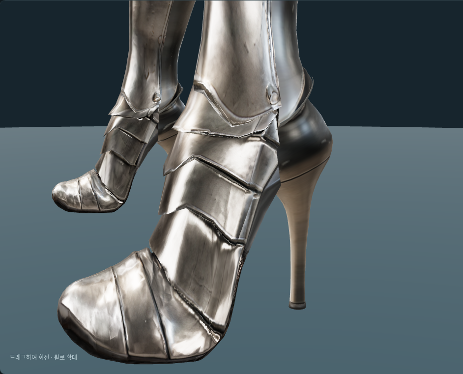

## 장갑과 투구 연결하기

장갑은 한쪽을 먼저 피팅하고 동작을 확인한 뒤 반대편을 만들었습니다. 좌우 손가락의 기준 자세가 달라 단순히 대칭 복사하는 것으로 끝내지 않고, 왼손의 실제 본 위치와 피부 표면에 다시 맞췄습니다.

처음 리깅한 장갑은 입구와 팔꿈치 보호대가 팔에 비해 너무 크게 벌어져 있었습니다. 아래는 그 상태를 확대한 모습입니다.

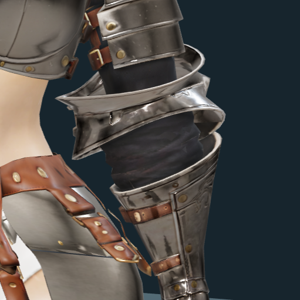

입구와 보호대의 폭을 줄여 팔에 맞춘 뒤에는 팔을 굽히는 동작을 확인했습니다. 전투 대기처럼 팔꿈치를 깊게 굽히면 보호대 윗부분이 위팔에서 떨어져 빈 내부가 보였습니다. 아래는 노란 원으로 그 부분을 표시한 수정 전 모습입니다.

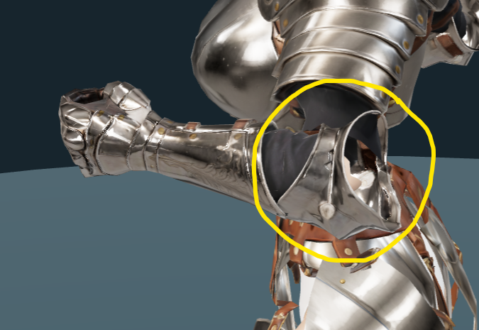

보호대가 아래팔만 따라 움직이던 가중치를 위팔과 아래팔에 나누고, 팔꿈치 안쪽에는 검은 천 안감을 만들어 연결했습니다. 장갑 밖으로 튀어나오던 상의 소매 끝도 장갑 착용 중에는 가리도록 했습니다.

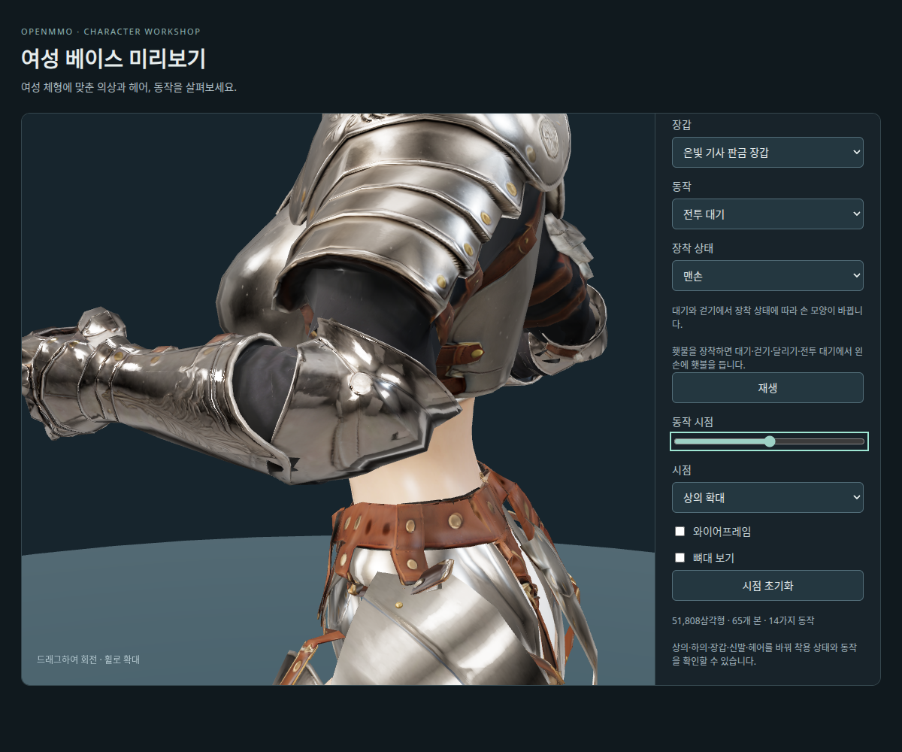

투구는 바이저가 올라가 얼굴이 보이는 형태로 만들고 여성 베이스의 실제 두상에 맞췄습니다. 전체가 머리 본을 따라 움직이며 바이저는 열린 상태로 고정했습니다. 투구를 쓰면 선택한 헤어를 숨기고, 벗으면 다시 보여 주도록 했습니다.

아래는 투구와 기사 장비를 착용한 제작 미리보기의 얼굴 확대 화면입니다.

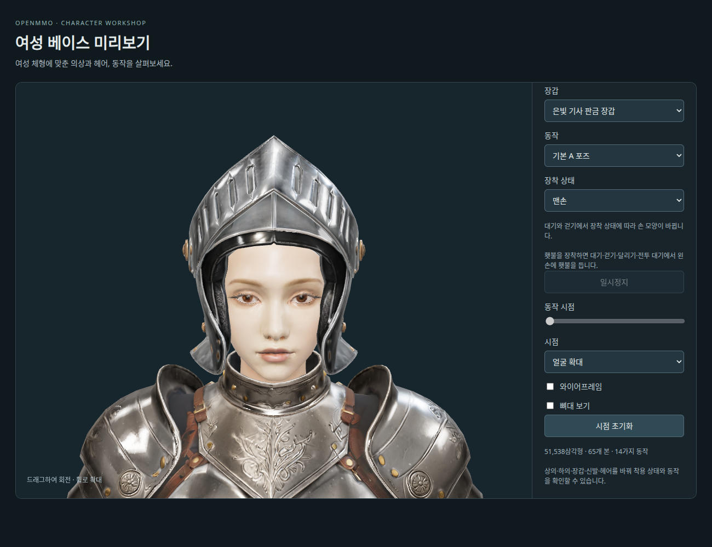

## 게임에 연결하고 장비 착탈 확인하기

여성 기사를 선택하면 새 모듈형 베이스와 투구·상의·하의·장갑·부츠를 표시하도록 연결했습니다. 새 캐릭터에게는 기존 남성 기사와 같은 성능의 기본 판금 장비 5종을 지급하고, 여성용 외형을 사용하게 했습니다.

장비에 가려지는 피부와 기본 의상은 착용 중에만 숨깁니다. 투구를 벗으면 단발을, 장갑을 벗으면 소매를 복원하고, 갑옷을 전부 해제하면 원래 베이스로 돌아갑니다. 이 가림 상태는 캐릭터마다 따로 관리해 다른 플레이어나 캐릭터 선택 화면에 영향을 주지 않도록 했습니다. 로딩 실패와 착용 도중 선택 변경도 확인했습니다.

제작용 원본과 게임용 모델은 따로 보관했습니다. 게임용은 컬러 텍스처를 최대 2K, 나머지를 최대 1K로 줄여 WebP로 변환했습니다. 부츠 자세와 접지, 검을 쥔 손가락 보정은 동작 파일에 미리 저장해 게임에서 매 프레임 다시 계산하지 않도록 했습니다.

현재 게임 연결 범위는 여성 기사와 판금 세트입니다. 다른 종류의 여성 의상 외형은 아직 없어, 여성 기사가 다른 갑옷을 장착해도 해당 부위는 판금으로 표시합니다.

투구까지 착용한 기사 세트는 가려진 영역을 포함하면 66,017삼각형, 실제 표시 메시 기준으로는 51,538삼각형입니다. 검·횃불·망토는 이 합계에 포함하지 않습니다. 기존 모듈형 캐릭터의 목표 예산보다 많아 추가 최적화가 필요합니다. 깊은 관절 굽힘에서의 간격과 다른 복장과의 혼합 착용도 더 확인할 부분으로 남아 있습니다.
