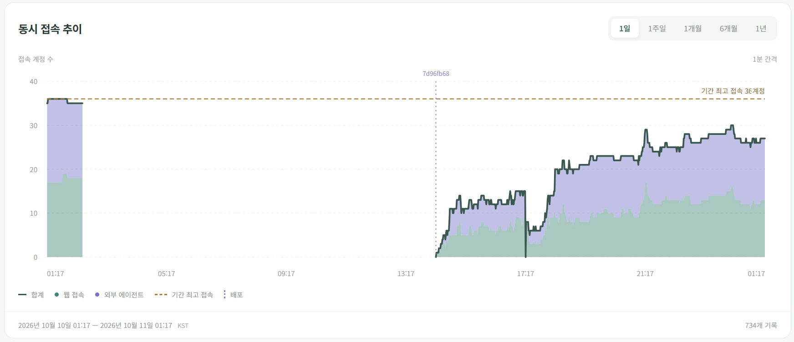

2026년 10월 10일, 서버에 데드락이 발생해 서비스가 10시간 동안 멈췄습니다. NPC 거래와 영지 보관함 처리가 골드와 인벤토리의 락을 서로 반대 순서로 잡으면서 발생한 문제였습니다.

그래프 중간의 긴 공백이 장애 구간입니다. 이 동안에는 동시 접속자 기록도 남지 않았고, 복구 후 기록이 다시 이어졌습니다.

## 원인: 골드와 인벤토리 사이의 ABBA 데드락

서버는 Rust와 Tokio를 사용하며, 골드와 인벤토리를 각각 `RwLock`으로 보호합니다. 문제가 된 두 작업은 다음 순서로 락을 획득했습니다.

| 처리 | 먼저 획득 | 잡은 채로 요청 |
| --- | --- | --- |
| NPC 거래 | 골드 쓰기 락 | 인벤토리 쓰기 락 |
| 영지 보관함 | 인벤토리 쓰기 락 | 골드 읽기 락 |

거래가 골드 락을, 보관함이 인벤토리 락을 하나씩 잡은 상태에서 다음 락을 요청하면 서로를 기다리게 됩니다. 두 작업 모두 상대가 락을 놓아야 끝날 수 있어 더 이상 진행하지 못합니다. 골드를 A, 인벤토리를 B라고 할 때 A → B와 B → A가 맞물리는 **ABBA 데드락**입니다.

보관함은 골드를 읽기만 했지만, 거래가 쓰기 락을 잡고 있어 읽기도 기다려야 했습니다. 이 락들은 전체 플레이어의 골드 맵과 인벤토리 맵을 보호하므로 서로 다른 플레이어의 작업끼리도 충돌할 수 있었습니다.

대기는 다른 공유 락을 보유한 작업을 통해 `players`와 `player_characters`로도 번졌습니다. Tokio의 `RwLock`은 앞서 대기 중인 쓰기 요청을 이후 읽기 요청이 앞지를 수 없어, 뒤따르는 작업들도 함께 멈췄습니다. [Tokio RwLock 문서](https://docs.rs/tokio/latest/tokio/sync/struct.RwLock.html)

## 수정: 락 순서를 통일하고 보유 시간을 줄이기

여러 락을 함께 잡을 때의 순서를 정하고 역순으로 접근하던 코드를 고쳤습니다. 영지 보관함은 골드 값을 먼저 복사하고 읽기 락을 해제한 뒤 인벤토리에 접근하도록 바꿨습니다. 가구 구매도 골드 → 인벤토리 순서로 맞췄습니다.

같은 문제가 다시 들어오는 것을 찾기 위해 락 의존 관계의 순환을 검사하는 `lockscan.py`를 CI에 추가했습니다. 모든 경로를 분석하는 도구는 아니지만, 순서 역전을 찾는 보조 검사로 사용합니다. [락 순서 수정 커밋](https://github.com/Julian-adv/OpenMMO/commit/db895da19f88014549a9c18952ff753e2ec2c1b2)

DB 저장이 끝날 때까지 골드와 인벤토리의 쓰기 락을 잡고 있던 처리도 정리했습니다. 사용할 아이템이나 골드를 먼저 확보하고 공유 락을 해제한 뒤 저장합니다. 저장에 실패하면 아이템과 골드를 돌려놓으며, 가구 구매의 저장 실패 시 상태가 유지되는지 확인하는 테스트도 추가했습니다. 이렇게 한 작업의 DB 대기가 다른 플레이어의 인벤토리 접근까지 막는 시간을 줄였습니다. [DB 저장 구간 수정 커밋](https://github.com/Julian-adv/OpenMMO/commit/b77434ac502ac1fafc35c77a6c74a28dc22f36e0)

## 게임 진행이 멈추면 감지하고 재시작

프로세스가 살아 있어도 게임은 멈춰 있을 수 있습니다. 이를 감지하기 위해 주기적인 게임 루프가 처리를 완료한 시각을 기록하고, `/api/health`에서 진행 여부를 확인하도록 했습니다. 헬스 체크는 게임의 공유 락을 사용하지 않아 해당 락이 막혀도 상태를 조회할 수 있습니다.

루프별 제한 시간 동안 진행이 없으면 비정상으로 판단하고 systemd에 보내는 watchdog 신호를 중단합니다. 그러면 systemd가 서버를 종료하고 재시작합니다. 강제 재시작 시 마지막 저장 이후의 변경은 유실될 수 있지만, 서버가 멈춘 채 장시간 방치되지 않도록 복구 장치를 추가했습니다. [헬스 체크와 watchdog 추가 커밋](https://github.com/Julian-adv/OpenMMO/commit/d5660940afe7c538778664729ba4a23e8fe21484)
