[지난 글 「Tripo Segment로 발키리 장비 만들기」](/blog/valkyrie-armor-segmentation/)에서는 완성된 발키리 모델을 나누어 손목 보호대와 부츠, 헬멧을 만드는 과정을 소개했습니다. 장비를 하나씩 따로 만들어 몸에 맞추던 방식보다 피팅과 리깅을 수월하게 진행할 수 있었습니다.

[처음 모듈형 캐릭터를 만들 때](/blog/modular-characters/)는 각 장비의 원화와 3D 모델을 따로 만들어 베이스 캐릭터에 붙였습니다. 소매와 어깨, 발목 등을 몸에 맞추는 데 시간이 많이 걸렸고, 크기를 맞춰도 움직이면 피부가 옷을 뚫고 나오거나 장비가 어색하게 꺾이곤 했습니다. 아스트라나 Sol이 피팅과 리깅을 수정해 주었지만, 장비가 늘어날 때마다 비슷한 작업을 반복해야 했습니다.

이번 글은 발키리 작업의 심화편입니다. 같은 방법을 다른 캐릭터와 의상에도 적용할 수 있도록, 여성 바드 복장을 예로 들어 원화 준비부터 모델 생성과 분할, 피팅과 리깅까지 자세히 정리했습니다. 목표는 상의와 하의, 장갑, 부츠 등을 교체하며 옷을 갈아입을 수 있는 모듈형 캐릭터를 만드는 것입니다.

## 1. 베이스 캐릭터 만들기

가장 먼저 할 일은 베이스 캐릭터를 만드는 것입니다. 앞으로 만들 옷과 장비를 맞춰 입힐 기준 몸체이며, 장비를 벗었을 때 보여 줄 모습이기도 합니다.

베이스에서는 체형과 신체 비율, 팔과 다리의 기본 자세를 먼저 잡습니다. 이후에 만드는 의상은 이 몸체를 기준으로 크기와 형태를 맞춥니다. 기준이 계속 바뀌면 이미 만든 장비도 다시 조정해야 하므로, 옷을 만들기 전에 몸체부터 정해 두는 편이 좋습니다.

아래는 캐릭터 미리보기에서 헤어와 장비를 숨긴 여성 베이스의 스크린샷입니다. 기본 상하의만 착용하고 팔을 비스듬히 벌린 A 포즈로 서 있어, 몸체의 비율과 팔·다리의 위치를 볼 수 있습니다.

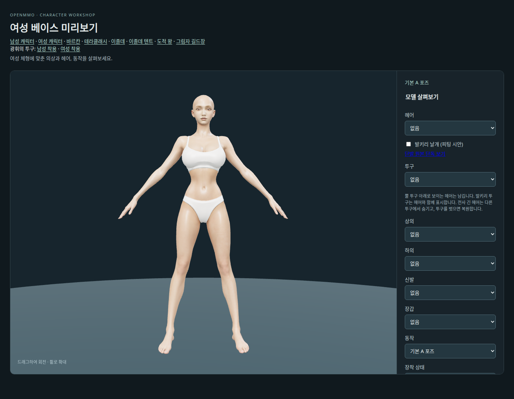

베이스를 만드는 세부 과정은 [「여성 캐릭터를 모듈형으로 만들기」](/blog/modular-female-character/)에 기록해 두었습니다. 여기서는 준비한 베이스에 입힐 교체 가능한 의상을 만드는 과정을 이어서 설명하겠습니다.

## 2. 만들 복장의 원화 그리기

베이스 캐릭터를 준비했다면 만들 복장의 원화를 그립니다. 먼저 캐릭터가 옷과 장비를 모두 착용한 모습으로 전체적인 형태와 색상, 소재의 조합을 정합니다.

이번 바드(음유시인) 복장은 기존 원화를 참고했습니다. 아래는 바지를 입은 여성 바드 원화로, 녹색 망토와 줄무늬 소매, 갈색 가죽 코르셋과 벨트, 부츠의 디자인을 가져오고 싶었습니다.

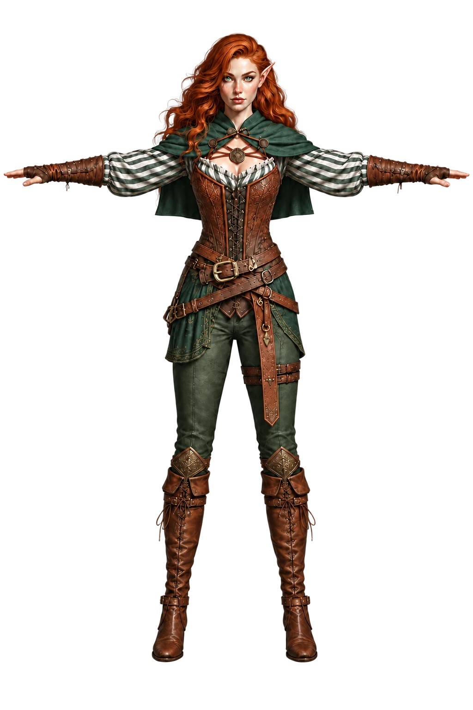

## 3. 원화를 베이스에 맞춰 그리기

복장 디자인을 정했다면 베이스의 체형과 자세에 맞춰 그립니다. **아래 이미지는 실제로 제작한 베이스 캐릭터의 3D 모델을 블렌더에서 렌더링한 화면입니다.** 기준 이미지는 이렇게 블렌더나 게임 안에서 실제 베이스 모델을 렌더링해 준비합니다. 하이힐 부츠를 만들 예정이라 발도 하이힐을 신는 각도로 맞춰 두었습니다.

베이스를 만들 때 사용한 원화와 완성된 3D 모델은 비율이나 형태가 달라질 수 있습니다. 따라서 복장 원화는 **완성된 베이스 모델의 렌더 위에 맞춰 그리는 것**이 중요합니다. 실제로 옷을 입힐 몸체를 기준으로 그려야, 그 원화로 생성한 메시도 베이스에 더 잘 맞고 이후 피팅에서 조정할 부분이 줄어듭니다.

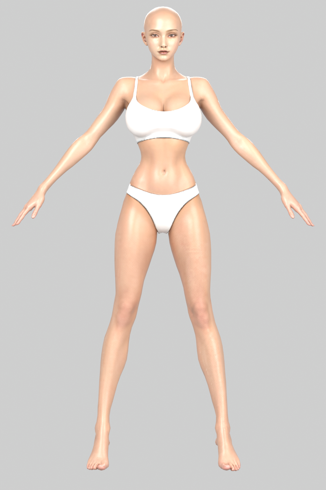

코덱스에 베이스의 어깨너비와 허리·골반 비율, 팔의 각도, 다리 길이와 발 위치를 유지한 채 그 위에 옷을 입히듯 그려 달라고 했습니다. 하의는 기존 바지 대신 짧은 치마로 바꾸도록 했습니다. 모델을 만든 뒤 체형을 다시 맞추는 작업을 줄이기 위해, 원화부터 베이스에 맞추려는 의도입니다.

그 결과가 아래의 치마를 입은 버전입니다. 베이스의 비율과 A 포즈에 맞춰 바드 복장을 입힌 원화입니다.

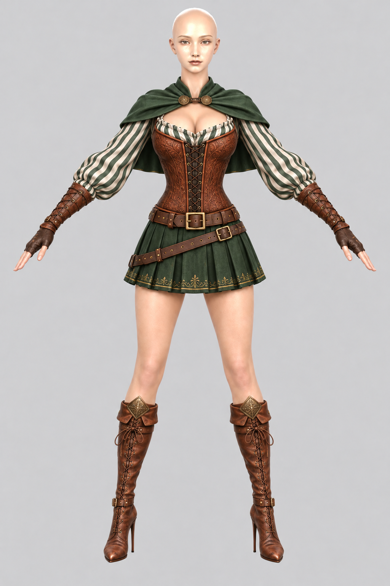

그린 원화는 베이스와 겹쳐 비교합니다. 아래 이미지의 왼쪽은 치마를 입은 원화이고, 오른쪽은 원화와 베이스를 각각 50%씩 섞은 화면입니다. 손과 무릎, 발의 위치를 비교하면 베이스의 비율과 자세에 얼마나 잘 맞게 그려졌는지 확인할 수 있습니다.

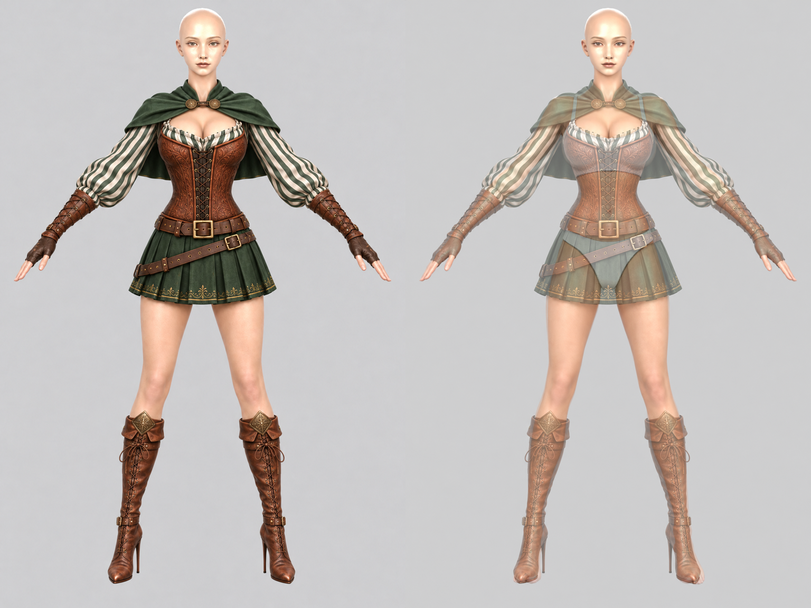

**이 단계에서 중요한 것은 원화를 베이스에 겹쳤을 때 몸의 실루엣과 자세가 최대한 잘 일치하도록 그리는 것입니다.** 어깨와 골반의 폭, 팔다리의 길이, 손과 발의 위치가 원화부터 어긋나 있으면 모델링 후에 그 차이를 피팅으로 다시 맞춰야 합니다. 원화부터 베이스에 잘 맞춰 두면 이후 모델의 어긋남을 줄이고 피팅도 훨씬 수월하게 진행할 수 있습니다.

겹쳐 봤을 때 맞지 않는 부분이 있으면 코덱스에 구체적으로 짚어 주고 수정하도록 지시합니다. 팔의 각도가 다르면 베이스의 팔에 맞춰 그리도록 하고, 다리가 짧아졌거나 발이 벌어졌으면 무릎과 발끝의 위치를 맞춰 달라고 하는 식입니다. 수정한 결과도 다시 겹쳐 보며 실루엣이 잘 맞을 때까지 이 과정을 반복합니다.

## 4. 트리포에 원화를 주고 모델 만들기

베이스에 맞춰 그린 원화를 트리포(Tripo)에 업로드해 3D 모델을 생성했습니다. 삼각형 수는 약 2만 개로 했습니다. 정면 원화 한 장만 줘도 잘 만들어 줍니다. 아래는 바드 원화로 생성한 모델입니다.

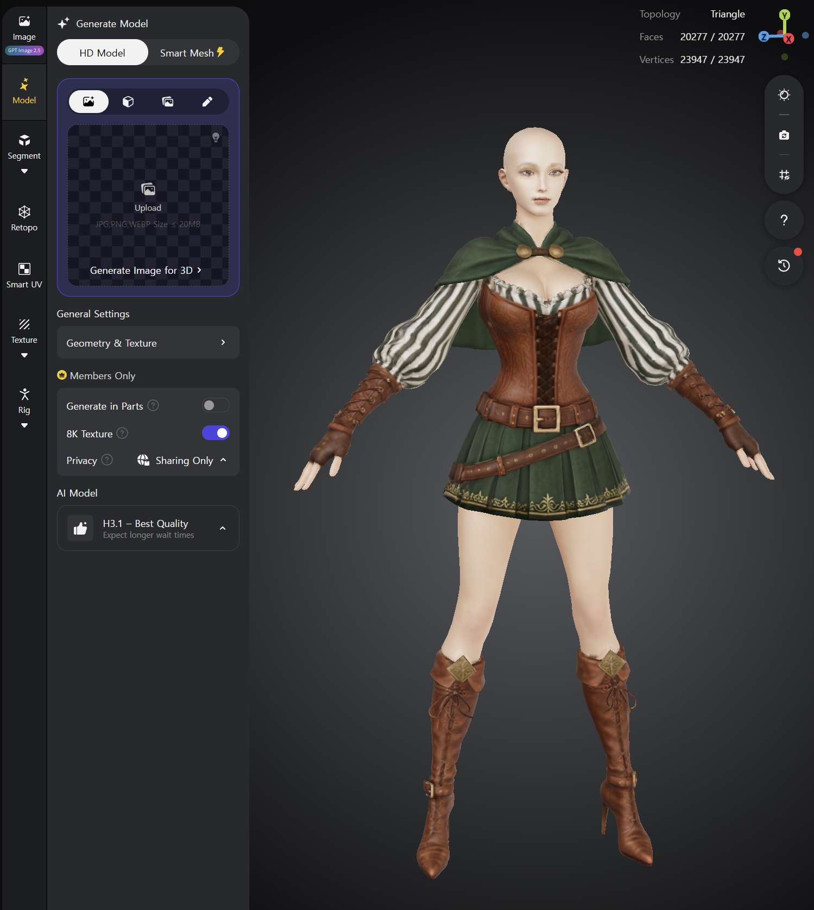

모델링이 끝나면 텍스처링을 합니다. 이어서 왼쪽의 **PBR** 버튼을 누르고 **Generate PBR**도 한 번 실행해 PBR 텍스처까지 만듭니다.

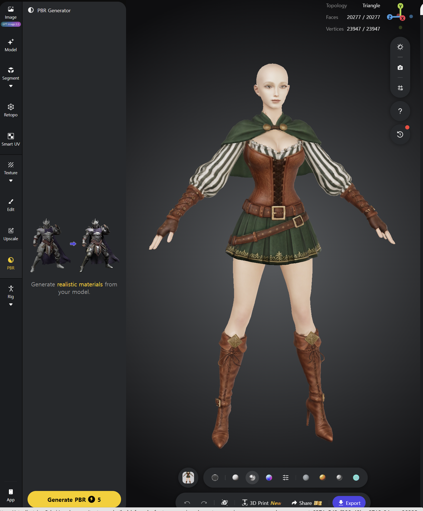

## 5. 세그먼트로 복장 나누기

텍스처까지 준비했다면 **Segment** 메뉴에서 모델을 분할합니다. 분할된 조각들을 실제로 갈아 끼울 복장 단위로 정리하는 작업입니다.

필요한 파트는 상의, 하의(바지나 치마), 왼쪽 부츠, 오른쪽 부츠, 왼쪽 장갑, 오른쪽 장갑입니다. 헬멧이나 헤어가 있으면 그것도 별도 파트로 정리합니다.

함께 사용할 조각은 **Merge**로 합칩니다. 먼저 한 파트를 클릭하고, **Ctrl을 누른 채 다른 파트를 클릭**해 추가로 선택한 뒤 Merge를 누르면 하나로 합쳐집니다.

작업 중에 오동작할 수 있으니, 중간중간 **Save**를 눌러 자주 저장하는 것이 좋습니다.

아래 화면에서는 좌우 허벅지가 서로 다른 색으로 표시되어 있어 각각 다른 파트임을 알 수 있습니다. Merge 사용법을 예로 들면, **화면 왼쪽 허벅지를 클릭한 뒤 Ctrl을 누른 채 오른쪽 허벅지를 클릭**하고 **Merge**를 누르면 두 파트가 합쳐집니다.

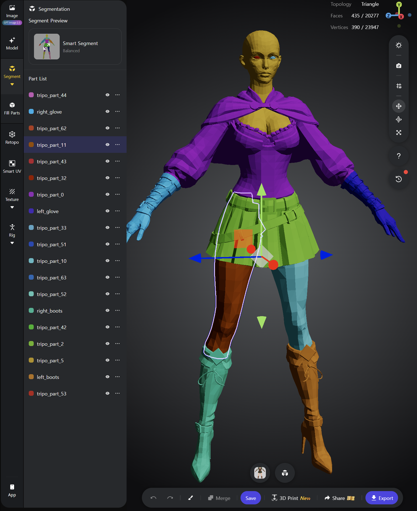

Merge한 파트는 이름도 바꿔 둡니다. 위 예제에서도 `left_boots`, `right_boots`, `left_glove`, `right_glove`처럼 부위를 알아볼 수 있게 이름을 붙였습니다. 나중에 모델을 클로드나 코덱스에 넘겨 작업을 맡길 때, 어떤 파트를 다룰지 전달하기가 더 편합니다.

원하는 경계대로 분할되지 않았다면 Merge만으로는 정리하기 어렵습니다. 이럴 때는 아래쪽의 **붓 모양 아이콘**을 눌러 브러시로 파트의 경계를 수정합니다.

예를 들어 장갑에 포함할 부분이 다른 파트에 속해 있다면, **스포이드로 장갑 파트의 색을 선택**한 뒤 해당 부위를 브러시로 칠합니다. 칠한 부분은 장갑 파트에 포함됩니다. 이때의 색은 파트를 구분하는 표시입니다.

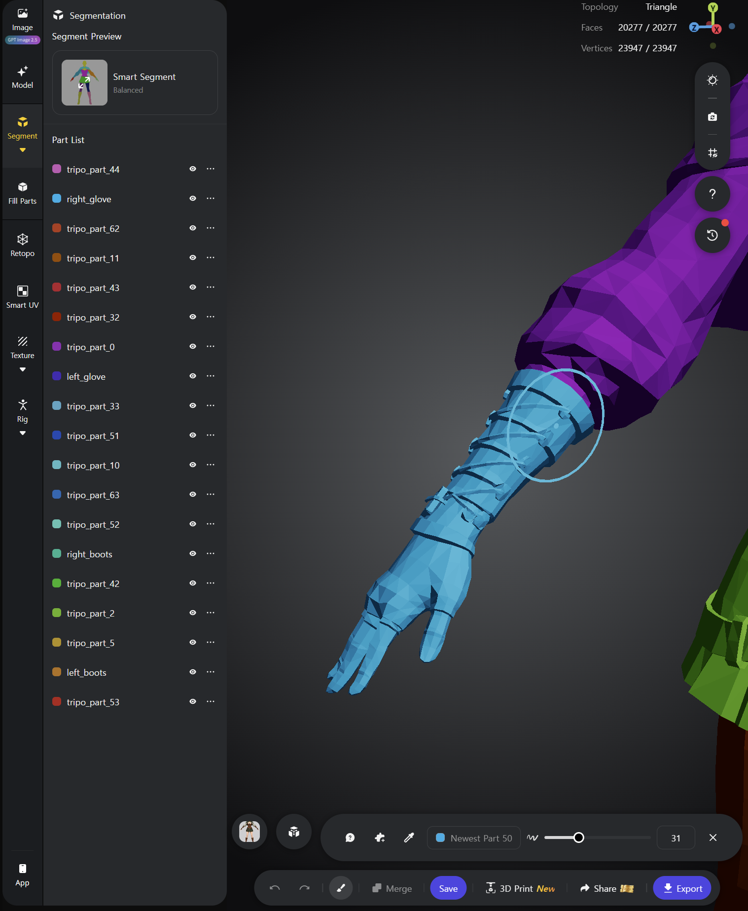

원하는 복장 단위로 정리한 뒤에는 마지막으로 **Save**를 누릅니다. 저장하면 하나로 합친 파트가 같은 색으로 표시되어, 어떤 부분이 함께 묶였는지 확인할 수 있습니다.

## 6. GLB로 내보내고 피팅과 리깅하기

파트 정리가 끝나면 **Export**에서 **GLB**로 내보냅니다. 내려받은 파일을 클로드에 주고, 기존 베이스 캐릭터에 맞춰 피팅과 리깅을 하도록 지시하면 됩니다.

GLB에서 상의와 치마, 좌우 부츠와 장갑 등 필요한 복장 파트만 따로 꺼내 기존 베이스 모델 위에 겹쳐 놓습니다. 각 파트의 크기와 위치, 형태를 베이스에 맞추는 것이 피팅이고, 베이스의 뼈대를 따라 움직이도록 연결하는 것이 리깅입니다.

옷에 가려지는 베이스의 몸체 부분은 착용용 메시에서 잘라 내거나, 화면에 그리지 않도록 숨김 처리합니다. 옷을 벗었을 때는 원래 몸체를 다시 보여 줄 수 있도록 베이스 원본은 유지합니다. 복장 파트를 베이스에 맞추고 가려지는 몸체까지 정리하면 기본 조립이 끝납니다.

아래는 여성 베이스에 바드 복장을 맞춰 입힌 미리보기입니다.

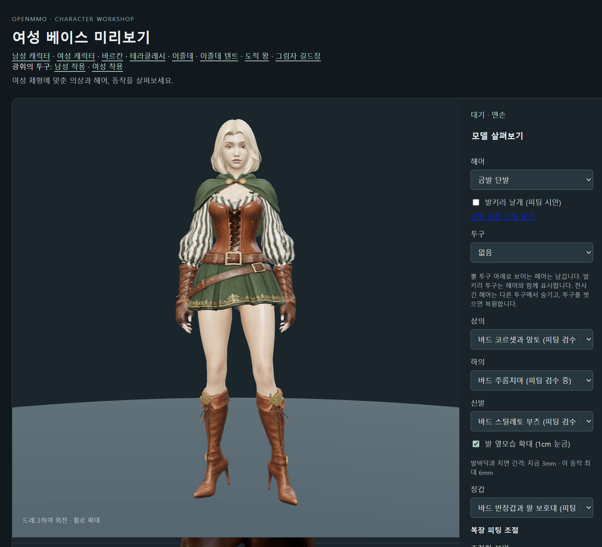

OpenMMO는 아이소메트릭 뷰라 캐릭터가 이처럼 크게 표시될 일이 없어, 실제 게임에서는 작은 어긋남이 눈에 잘 띄지 않습니다. 확대해서 보면 소매와 장갑, 다리와 부츠가 연결되는 부위가 말끔하지 않거나 조금씩 어긋난 경우가 많아 미세 수정이 필요합니다.

미세 수정을 위해 캐릭터 미리보기 프로그램에 조절 메뉴를 만들었습니다. 부위별 위치와 크기, 너비·높이·두께, 회전과 기울기를 조절하며 연결 부위를 맞출 수 있도록 했습니다.

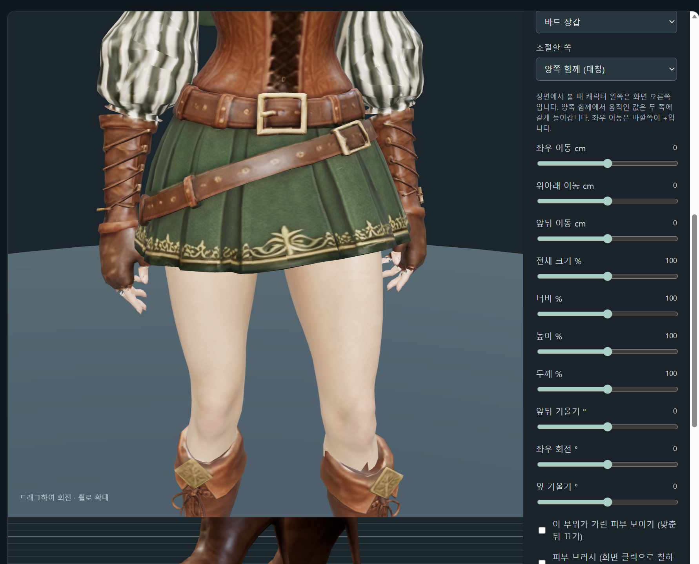

[이 링크를 눌러 트리포에 가입하시면 할인을 받을 수 있습니다.](https://studio.tripo3d.ai/?utm_source=creator_invite&utm_medium=linkcopy&utm_campaign=referral_landing_page&invite_code=W0EX4I&uid=8878291)

[OpenMMO에서 직접 플레이해 볼 수 있습니다.](https://openmmo.to.nexus)

이 작업에 사용한 프롬프트와 중간 단계 원화 등 제작 자료는 [OpenMMO GitHub 저장소](https://github.com/Julian-adv/OpenMMO)에서 볼 수 있습니다.

[Tripo 공식 카카오톡 오픈채팅방](https://open.kakao.com/o/p9QNacSi)
