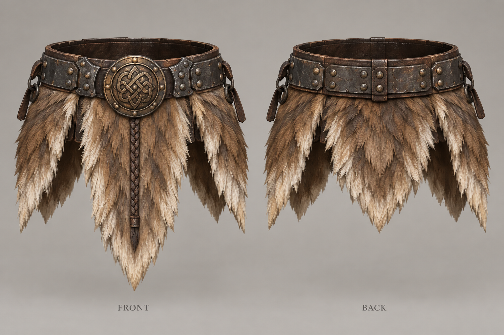
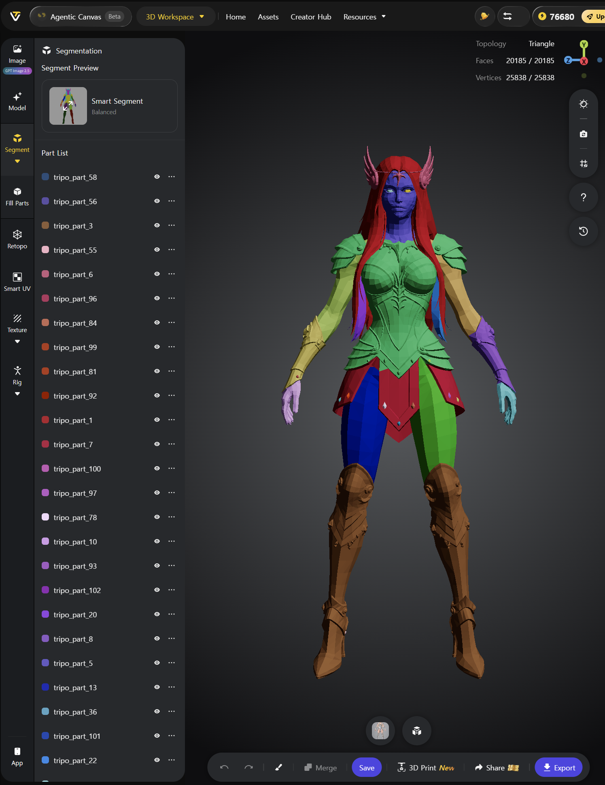
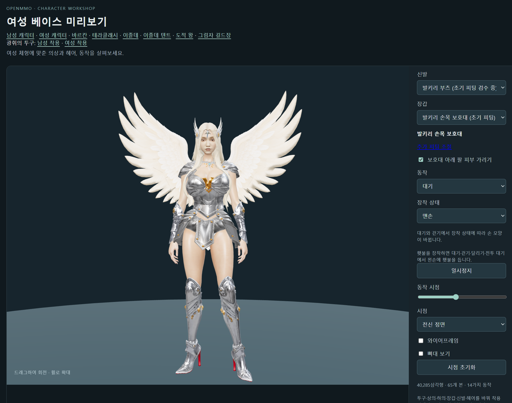

발키리의 손목 보호대와 부츠, 헬멧은 Tripo의 Segment 기능을 이용해 만들었습니다. 발키리 모델을 부위별로 나누고 필요한 장비 부분을 분리하는 방식입니다.

이전에는 장비마다 원화를 따로 그리고 모델을 만든 뒤, 아스트라나 Sol에게 캐릭터에 맞추는 피팅과 리깅을 맡겼습니다. 따로 만든 장비는 몸에 잘 맞지 않기도 해서 이를 조정하는 데 시간이 오래 걸렸습니다.

아래는 개별 장비를 만들기 위해 따로 그린 원화입니다. 이 원화를 바탕으로 모델을 만든 뒤 캐릭터에 피팅하고 리깅하는 과정이 많이 힘들었습니다. 물론 GPT Sol이 하지만요.

이번에는 완성된 발키리 모델에서 장비 파트를 나누어 익스포트한 뒤 캐릭터에 붙였습니다. 이미 캐릭터에 맞춰진 형태를 사용할 수 있어 피팅과 리깅을 훨씬 빠르게 진행할 수 있었습니다.

## 발키리 모델 분할하기

Tripo의 Smart Segment를 적용하면 모델이 여러 파트로 나뉩니다. 아래 화면에서는 각 파트가 서로 다른 색으로 표시되어 몸체와 장비의 경계를 확인할 수 있습니다. 왼쪽 목록에는 분할된 파트가 나열됩니다.

## 너무 잘게 나뉜 파트 합치기

Segment는 필요한 것보다 파트를 지나치게 잘게 나누는 경향이 있습니다. 이 발키리 모델에서는 부츠에 붙은 리벳 같은 작은 장식까지 각각 별도의 파트로 나뉘었습니다.

함께 사용할 파트들을 Ctrl을 누른 채 클릭해 여러 개 선택하고, **Merge**를 눌러 하나로 합쳤습니다. 부츠도 리벳과 다른 조각들을 하나로 합친 뒤 **Save**를 눌러 저장하고 **Export**했습니다. 분할 결과를 그대로 내보내기 전에 필요한 파트들을 합치고 저장해야 합니다.

이렇게 나눈 모델에서 손목 보호대와 부츠, 헬멧에 해당하는 부분을 이용해 각각의 장비를 만들었습니다. 완성된 캐릭터의 형태를 기준으로 필요한 부위를 분리해 피팅과 리깅이 더 빠르고 쉬워졌습니다.

아래는 완성된 발키리 모델입니다.

